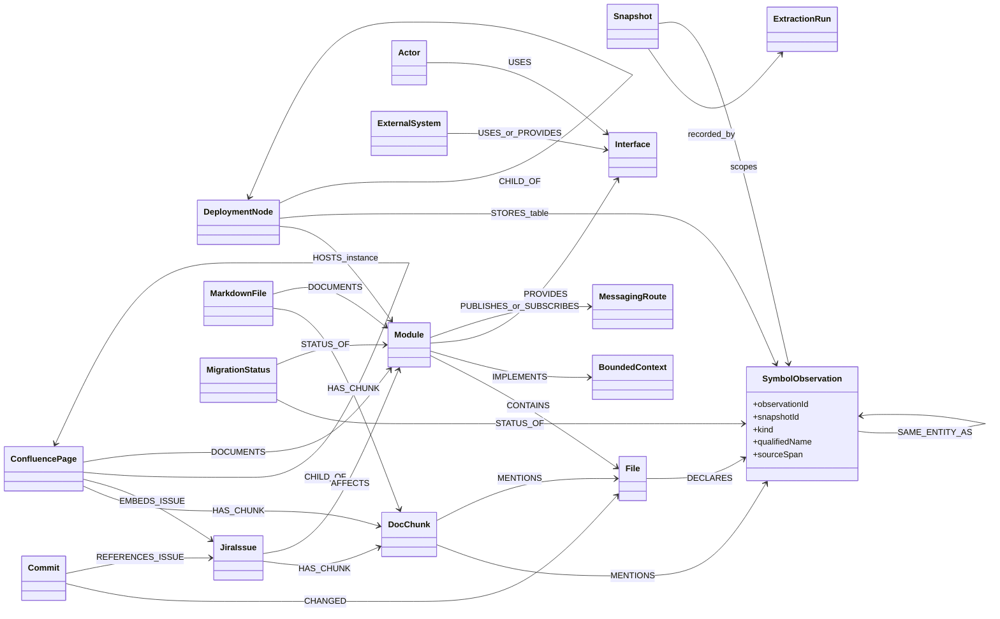
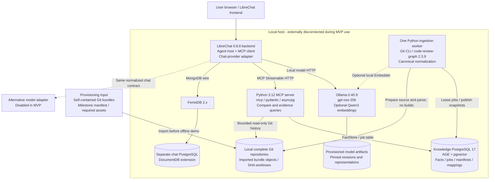
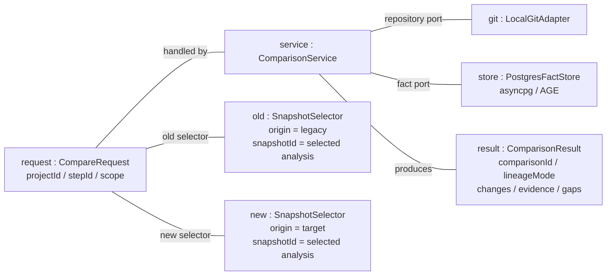
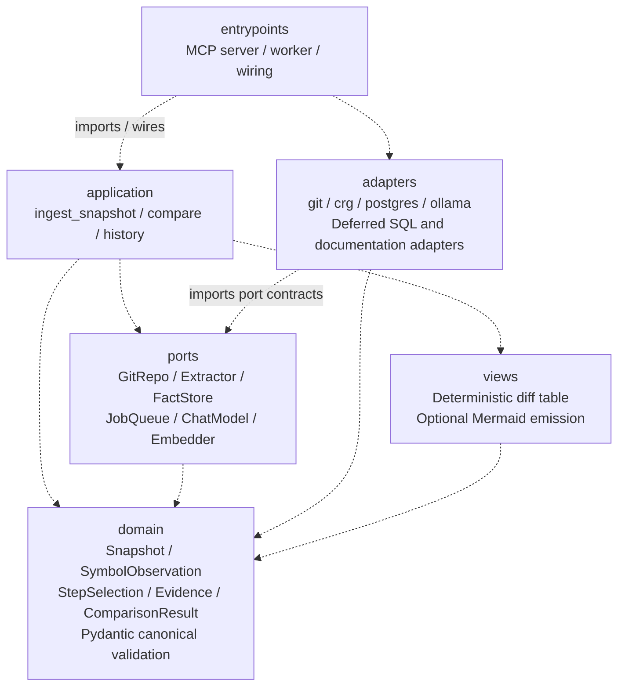

# Migration Assistant: Architecture Contract

## 1. MVP

| ID | Suggestion | Scope / verification |
|---|---|---|
| D1 | Retain the architecture's snapshot-scoped schema: Module, File, SymbolObservation, Commit, architecture and documentation observations, MigrationStatus and ExtractionRun provenance. | Do not replace it with a competing Class/Method/Field-only graph. |
| D2 | Canonical validated JSONL is the extractor-to-loader contract. | Deterministic facts are separate from LLM explanations. |
| D3 | Adopt Vision A's PostgreSQL 17 + AGE + pgvector knowledge store, accessed through an asyncpg-backed FactStore. | Selected direction, not a claim that the recorded AGE artifact or extension matrix has passed testing. |
| D4 | ADAPT code-review-graph 2.3.9; own normalization, loader, evidence and comparison logic. | No fork required; language coverage must be measured. |
| D5 | Git-native input with preserved history; prefer self-contained Git bundles for offline delivery. | Local complete repositories also accepted; no shallow/partial-object dependency during the offline demo. |
| D6 | Shared explicit migration-step manifest and separate source/analysis/run/comparison identities. | Both origins and all selected milestones use the same rules. |
| D7 | One local end-to-end chat function is the MVP: pinpoint old/new code changes and explain available history with evidence. | Ingestion-only is not the MVP; operational migration completion is not implied. |
| D8 | Local inference by default through provider-neutral boundaries. | Ollama adapter implemented first; other provider implementations are deferred. |
| D9 | MCP is the chat-to-backend interface; job_status is the single polling tool name. | LibreChat host executes suggested calls; model is not the MCP client. |
| D10 | No analyzed repository builds or execution; local read-only source inputs; staged publication. | One worker initially, durable job table, lease/retry/idempotency safeguards. |


MVP realization: a user asks the local chat to compare selected old/new code; the system returns changed files and code locations, available commit evidence and an explanation. Both origins use the same ingestion and query contracts. The architecture describes the target system but requires only this vertical chat slice for the MVP. It does not claim implementation or passing tests.

## 2. Source and identity boundary

Inputs are self-contained Git bundles or complete local Git repositories with the necessary history and objects. Resolve tags/branches once, pin full commit IDs, and then operate locally. A self-contained bundle preserves selected reachable Git history for offline handoff; ordinary source archives do not provide that history.

Provisioning includes all selected commits, required blobs, model artifacts, images and dependencies. Missing objects, submodule repositories or external assets are explicit input failures or declared coverage exclusions. No lazy network fetch is allowed during the externally disconnected MVP demonstration. The previous mandatory blobless-clone assumption is superseded by the offline completeness requirement.

## Shared identity contract

A migration step is a project milestone, not a commit and not an extraction run. Use the same manifest and identity rules for both legacy and target.

| Field / identity | Contract |
|---|---|
| `projectId` | Stable project-assigned identifier for the reference system. |
| `stepId` | Stable opaque milestone key, for example `step-03`; unique within the project. |
| `ordinal` | Explicit milestone order; never inferred from commit dates or tag spelling. |
| `members[]` | Each entry binds `repoId`, `origin` (`legacy` or `target`), and full `commitSha`; optional source subdirectory is part of extraction configuration. |
| `repoId` | Stable configured repository identity, independent of local path or mutable remote URL. |
| `sourceSnapshotId` | SHA-256 of canonical JSON of `repoId` and full `commitSha`. |
| `snapshotId` | Analysis identity: SHA-256 of canonical JSON of `sourceSnapshotId`, `schemaVersion`, `extractorSetDigest`, and `extractionConfigDigest`. This is the Snapshot identifier used by tools and graph facts. |
| `runId` | Unique extraction-attempt identifier; distinct attempts may produce the same semantic analysis snapshot. |
| `comparisonId` | SHA-256 of canonical comparison inputs: project/step, explicitly ordered old/new analysis selectors, scope, comparison policy version and accepted mapping digest. |

Canonical JSON means UTF-8, sorted object keys, no insignificant whitespace, and no timestamps or local paths in identity inputs. SHA values retain their repository object-format length; do not assume every repository uses the same hash format. Hash inputs use exact field names from the shared JSON contract, with versioned normalization in implementation.

A single repository may supply both origins via distinct paths or refs. Distinct repos can likewise supply a milestone pair. `origin` is a role within a manifest selection, not something inferred from repository age. Step membership is a separate association: the same source or analysis snapshot may be reused in several milestones without changing its identity. Queries return `projectId`, `stepId` and `origin` through the selected manifest member, rather than stamping one exclusive step into a reusable observation.

Illustrative manifest (not partner-supplied data):

```json
{
  "projectId": "reference-system",
  "stepId": "step-03",
  "ordinal": 3,
  "members": [
    {"repoId": "legacy-repo", "origin": "legacy", "ref": "refs/tags/step-03", "commitSha": "<full-resolved-commit-id>"},
    {"repoId": "target-repo", "origin": "target", "ref": "refs/tags/step-03", "commitSha": "<full-resolved-commit-id>"}
  ]
}
```

Refs are recorded for usability; resolved commits are authoritative. Seven milestone entries may be registered, but the MVP must work on one explicit pair before demonstrating all available steps. Missing origin members fail a requested old/new comparison clearly; no silent selection of another branch or step.


## 3. Canonical graph and fact contract (D1, D2)

### 3.1 Retained architecture vocabulary

The following is the architecture's schema, not a replacement schema derived from the old issue wording. SymbolObservation remains the typed observation for code entities and tables. Preserve supported `kind` values such as class, method and table; add field observations only as a compatible typed extension when the extractor actually supports them. No schema change to separate Class/Method/Field nodes is required by this contract.\


The diagram is a vocabulary overview, not an exhaustive cardinality or physical AGE DDL specification. Full relationship rules:

| Area | Required target semantics | MVP activation |
|---|---|---|
| Source | Module CONTAINS File; File DECLARES SymbolObservation; Commit CHANGED File; supported symbol CALLS observations. | Module/file/symbol observations and commit changes where supported; missing call resolution is reported. |
| Correspondence | SAME_ENTITY_AS carries method, state and evidence. | Explicit user selection or configured accepted mapping is sufficient; name-based proposals cannot establish identity. |
| Architecture | Actor, ExternalSystem, Interface, BoundedContext, DeploymentNode, MessagingRoute; USES, PROVIDES, IMPLEMENTS, HOSTS with instance metadata, STORES, PUBLISHES/SUBSCRIBES and CHILD_OF. | Retained vocabulary; populate only from available evidence, not inferred from the chat deployment. |
| Documentation | JiraIssue, ConfluencePage, MarkdownFile, DocChunk; HAS_CHUNK, EMBEDS_ISSUE, CHILD_OF, REFERENCES_ISSUE, MENTIONS, DOCUMENTS and AFFECTS. | Deferred integration; no Jira/Confluence input required for Git comparison. |
| Assessment | MigrationStatus STATUS_OF Module or SymbolObservation, with rule/version and evidence IDs. | Retained; code-difference results do not require or imply MIGRATED or RETIRED status. |
| Provenance | Snapshot scopes all observations; ExtractionRun records inputs, tools and configuration; relationship evidence is queryable. | Mandatory for every published comparison fact. |

Retain HOSTS-instance metadata and table-kind SymbolObservation from the existing model; separate DeploymentInstance or DatabaseObject nodes are not silently introduced. A future schema refactor requires a versioned change. Aggregated class-coupling edges may be derived later but are not a prerequisite of this selected MVP.

### 3.2 JSONL and provenance

Each record has `schemaVersion`, `recordType`, stable record ID, `snapshotId`, payload and evidence references. Node identity is snapshot-scoped: use kind, normalized repository-relative path and qualified signature where known; never rely solely on a short name. Relations have typed endpoint IDs and evidence references. Source spans record repository, full commit, relative path and line range; path and language normalization are versioned.

The manifest/selection supplies origin and step context to tool responses and exported fact views. Reused observations may belong to multiple step selections without duplicate intrinsic identities. ExtractionRun records exact package identity/version, configuration digest, source snapshot, extractor-set digest, failures and coverage. Runtime timings and attempt IDs belong to run metadata, not deterministic semantic identity.

Commit history spans more than the current source tree. A historical change may reference a historic file locator rather than requiring a nonexistent File in the current snapshot; removal must not fabricate a present-day observation. Every response selects both snapshots explicitly, never an unqualified latest-symbol query.

## 4. Runtime architecture (D3-D5, D8-D10)



Seven selected local services are shown: LibreChat, FerretDB, chat PostgreSQL, MCP server, worker, knowledge PostgreSQL and Ollama. Compatibility is a verification gate; these are not asserted to be deployed. One worker initially; no Redis, distributed queue or horizontal scale-out requirement.

Knowledge PostgreSQL hosts AGE, pgvector, manifests, jobs and facts. Chat PostgreSQL is separate and uses the DocumentDB stack selected for FerretDB. All runtime calls stay local. Repository preparation and optional remote synchronization occur before offline mode; external model-provider adapters are disabled. No reverse proxy or unlisted service is silently required by this diagram. Local HTTP is loopback/private-network only; exposed deployments require a separate security review.

Claim jobs with a durable lease and transactional acquisition. SKIP LOCKED can assist acquisition but is not an exactly-once guarantee: unique analysis keys, idempotent writes and publication ownership are required. Stage/validate facts before a short atomic ready-publication step. Never hold a transaction across parsing or model inference. Retry/crash leaves either an earlier ready snapshot or a visible failed/staged attempt, not a partial ready result.

Treat input repositories as untrusted: disable hooks, filters, recursive submodule execution and external helpers; isolate Git configuration, validate local input roots, avoid shell interpolation and never run repository builds. Parser scratch outputs are writable outside the source tree; source worktrees remain read-only during extraction. Resource and history limits are configurable and disclosed when truncation occurs.

## 5. Objects and runtime behavior (D6, D7, D9)

```mermaid
sequenceDiagram
    autonumber
    actor U as User
    participant C as LibreChat host
    participant L as Local chat model
    participant M as MCP facade
    participant D as Knowledge store
    participant W as Ingest worker
    participant G as Local Git cache
    U->>C: Compare old/new component at selected step
    C->>L: Question and permitted tool definitions
    L-->>C: Suggested compare call
    C->>M: compare(projectId, stepId, old, new, scope)
    M->>D: Resolve manifest and both analysis snapshots
    alt One or both selected snapshots are missing
        M->>D: Enqueue idempotent jobs for missing selections
        M-->>C: state queued; job IDs; pinned selections
        W->>D: Claim lease
        W->>G: Read exact commits and local objects
        W->>W: Extract and validate canonical JSONL
        W->>D: Stage facts and atomically publish ready snapshots
        C->>M: job_status(jobId) when refreshed
        M-->>C: Ready or failed with coverage
        C->>M: Retry same pinned compare inputs when ready
    end
    M->>G: Read bounded history and endpoint diffs
    M->>D: Read both graph scopes and accepted maps
    M->>M: Build deterministic comparison and evidence table
    M-->>C: Result or explicit incomplete/error state
    C->>L: Ready evidence only; gaps and lineage mode
    L-->>C: Explanation citing evidence IDs
    C-->>U: Explanation and original diff/evidence artifact

```

The host controls tool invocation and model context. Refresh/retry is host-driven or explicitly requested; the model is not expected to wake itself later. Queued, failed and incomplete states are typed results. An optional MCP progress capability does not replace durable `job_status` or assume all hosts can consume it.

Instance snapshot during a comparison; plain lines mean references rather than chronological calls:



Request/selectors/results are request-lifetime values. Connection pools are process-lifetime; snapshots/manifests/evidence are persisted beyond requests. Published snapshot facts are immutable; new extraction configuration gives a new analysis identity. Review decisions and correspondence changes are separate versioned records; original provenance remains available.

## 6. Code organization and model adapters (D4, D8)



Dashed arrows denote source imports toward owned abstractions. Entry points wire adapters. Domain may use Pydantic; MCP entrypoints may use the MCP SDK. Integration-specific clients remain in adapters. Views operate deterministically over owned models. Replacing a provider can also require configuration, capability tests, deployment and SBOM updates; do not promise only one source file changes.

Provider-neutral contracts:

| Port | Required semantics |
|---|---|
| `ChatModel.generate(ChatRequest)` | Normalized messages, available tool schemas, model configuration and limits in; text/tool-call proposals, finish reason and errors out. Capability flags expose tool-call and structured-output support. Unsupported capabilities fail explicitly. |
| `Embedder.embed(texts, modelSpec)` | Vectors plus model artifact/revision, dimensions and settings. Query/index identity must match; changing vector model requires separate vector sets or reindexing. |
| `GitRepo` | Resolve local ref, validate object completeness, check ancestry, read bounded log/diff/blame and source spans at exact commits. |
| `Extractor` | Pinned read-only source and extraction configuration in; canonical facts plus explicit coverage/errors out. |
| `FactStore` | Stage/publish/query explicit snapshot scopes; no arbitrary model-generated SQL or Cypher. |

LibreChat's host-side chat-provider adapter is the authoritative chat orchestration path. Configure its Ollama integration first and validate the same normalized behavior using contract fixtures. Backend Python ChatModel is an optional port for future backend-generation use cases, not a second required chat loop. Python Embedder is implemented through the SBOM Ollama client when embeddings are enabled. Other models/runtimes must fit these boundaries without changing schema, comparison identity or evidence semantics.

## 7. MCP tools and comparison result

One naming convention across both files: snake_case tool names and camelCase JSON fields.

| Tool | Input and behavior |
|---|---|
| `analyze_repo` | `repoId`, `ref` or `commitSha`, extraction configuration; return ready `snapshotId` or queued `jobId`. Inputs reference registered local sources; no arbitrary remote URL or unrestricted filesystem access. |
| `job_status` | `jobId`; return state, pinned source selection, progress/coverage, ready snapshot or error. |
| `compare` | `projectId`, `stepId`, explicit ordered `old` and `new` selectors, scope and optional accepted mapping. Resolve immutable snapshot IDs and return ready result or required job IDs. Never silently change the selected comparison when a ref moves. |
| `history` | `repoId`, `commitSha` and bounded path/symbol/range scope; return commits, source locators and coverage. |
| `code_for` | Evidence locator or snapshot-scoped entity; return source text at the exact revision. |
| `arc42_view` | Explicit snapshot scope and view type; retained target API, not required for the comparison MVP. |

Retained future tools include migration_status, list_by_status, diff_snapshots, trace, docs_for and search_docs. They are not all claimed implemented or included in MVP acceptance.

A ready ComparisonResult includes `comparisonId`, contract/policy versions, old/new selectors, lineageMode (`ancestor_range`, `divergent`, `separate_repositories`), changes, commit evidence, accepted mappings, coverage and limitations. A change includes change kind, old/new source locations (nullable for additions/deletions), supported symbol observations, diff evidence, relevant commits where resolvable and evidence IDs. `state` distinguishes ready, queued, incomplete and failed. No numerical confidence is fabricated.

Same-repo endpoint diff uses explicitly selected commits; range/history policy and merge handling are recorded. Git rename detection uses configured similarity, so rename candidates remain evidence rather than proof of semantic identity. [web:96] Cross-repo comparison relies on explicit selection/configured mapping; neither commit dates nor names create a common ancestry. Explain historical intent only when commit text or other evidence actually states it.

Original diff/table artifacts are passed through separately from model prose. The model explains retrieved facts with resolvable evidence IDs and reports gaps; it cannot write authoritative statuses, accepted mappings or graph facts. The UI's artifact display must be tested, not assumed.

## 8. Concrete materials and incremental activation

Versions are copied from the design SBOM, not independently verified release claims. [file:89]

| Material | Role | MVP activation |
|---|---|---|
| Python 3.12; git; mcp; Pydantic; asyncpg | Local application, history, protocol, validation, persistence | Required; unpinned versions resolved at lock time. |
| code-review-graph 2.3.9 | Structural extraction behind owned adapter | Required for supported-language slice; no codebase execution implied by extractor invocation. |
| PostgreSQL 17 + AGE 1.7.0 PG17 entry | Knowledge persistence | Required; reconcile rc-tag artifact identity and test asyncpg conversions. |
| pgvector; Qwen3-Embedding-0.6B | Optional semantic retrieval extension | Retained architecture, not needed for explicit code comparison. |
| Ollama 0.40.9 + gpt-oss-20b | Local chat model/runtime | Required; provision model revision/representation offline. |
| LibreChat 0.8.8 + FerretDB 2.x + DocumentDB/PostgreSQL | Local chat host/persistence | Required selected integration; smoke test before claiming runnable MVP. |
| SQLGlot 30.22.0; markdown-it-py; markdownify; atlassian-python-api 5.0.5 | SQL, Markdown and external documentation | Retained target adapters; activate only if needed by selected slice. |
| pytest; cyclonedx-bom; Syft; pip-licenses | Verification and inventory | CI/dev only; no dependency inferred implemented from this document. |

MongoDB, Meilisearch and Redis remain excluded per Vision A. Remove unused default services through a tested deployment definition. Precision extractors, PyYAML direct use and import-linter are not silently adopted here: activate and update SBOM if actual code requires them. A direct import must be declared even if its package also arrives transitively.

## 9. Acceptance and synchronization

Run ADR tests T1-T10. D1-D10 here and in the ADR have identical text; the following JSON block must also match exactly after parsing. Enforce these checks in CI together with fixture/result contract tests. Acceptance tests are specified, not executed in this delivery. Mermaid blocks have been checked for fence/header completeness only; no Mermaid parser, browser layout or integration test was run for these newly generated files.

Changing one contract without its companion fails the review. Keep old documents as historical context or explicitly superseded; do not circulate the corrupted presentation as another current specification. This pair supersedes conflicting schema/status/MVP/source-delivery wording in the earlier issue and presentation, without rewriting their historical records. [file:94][file:93]

## 10. Shared synchronization block

```json
{
  "contract_id": "MA-CONTRACT-1.0",
  "decision_status": "Accepted design direction; implementation verification pending",
  "schema_authority": "architecture-contract.md section 3; existing architecture schema retained",
  "source_delivery": "Git-native; self-contained Git bundles preferred for offline handoff; local repositories accepted",
  "migration_step": "projectId + stepId; explicit ordinal; members bind repoId + origin + commitSha",
  "source_snapshot": "SHA-256 of canonical JSON containing repoId and full commitSha",
  "analysis_snapshot": "SHA-256 of canonical JSON containing sourceSnapshotId, schemaVersion, extractorSetDigest, extractionConfigDigest",
  "comparison": "SHA-256 of canonical JSON containing projectId, stepId, ordered old/new analysis snapshot selectors, scope, comparisonPolicyVersion, mappingDigest",
  "mvp": "Local chat pinpoints old/new code differences using graph facts, Git history and file/line evidence",
  "knowledge_store": "PostgreSQL 17 + Apache AGE + pgvector; asyncpg adapter",
  "models": "Local Ollama by default; provider-neutral chat and embedding contracts; no external provider enabled in MVP",
  "tool_names": [
    "analyze_repo",
    "job_status",
    "compare",
    "history",
    "code_for",
    "arc42_view"
  ],
  "ingestion": "Deterministic canonical JSONL facts; no repository builds or execution; staged atomic publication",
  "history_policy": "Same-repository ancestry checked; cross-repository histories kept distinct; no fabricated shared lineage",
  "unknown_policy": "Report missing history, unresolved symbols and unconfirmed mappings; no migration-completion claim from a diff alone"
}
```
