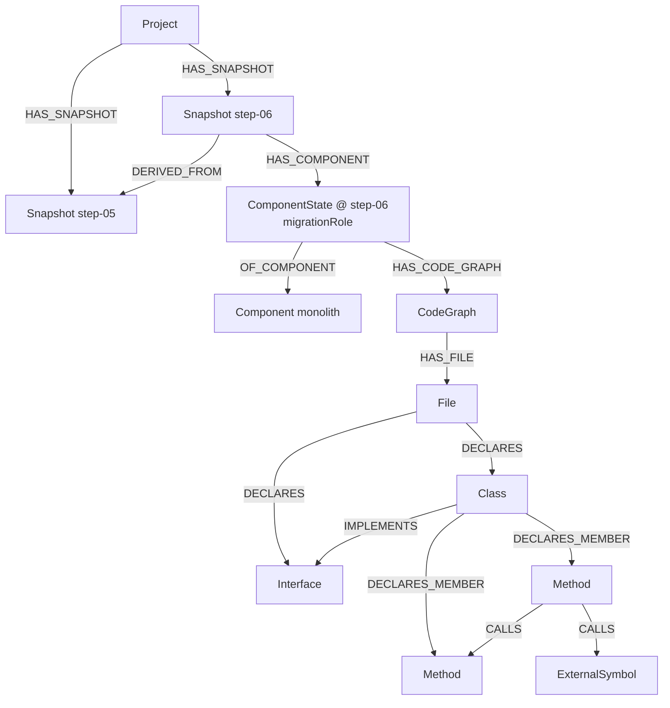

# Initial Graph Schema (Issue #21) – v2

Status: **v2**, implemented and tested. It replaces v1 (PostgreSQL + Apache AGE, `SymbolObservation`).
Decision of the team: follow **SBOM Vision B (Neo4j)** and the schema research of **issue #77 by Rafael** (`rafael-schema.md`, sections 2.1–2.5). The node and edge vocabulary below is his; this ticket adds the code that checks it.
Target store: **Neo4j**. Nothing here depends on PR #84 or PR #85 (both are not merged).

Where the code is:

| What | Path |
|---|---|
| Node and edge models | `backend/app/graph_schema/models.py` |
| Rule checker (`validate_graph`, `assert_valid_graph`) | `backend/app/graph_schema/validator.py` |
| Mock graph step-05 → step-06 | `backend/app/graph_schema/mock_data.py` |
| Tests | `backend/tests/test_graph_schema.py` |

The package is called `graph_schema`, not `graph`, because #85 will add `backend/app/graph/`.

## 1. Idea in simple words

- A **Project** has several **Snapshots** (steps of the modernization, for example `step-05`, `step-06`).
- A **Component** (for example `monolith`) is one stable identity. In each snapshot it appears as a **ComponentState**.
- A ComponentState has a **CodeGraph**: the result of the code extraction. The CodeGraph holds **Files**; Files declare **Classes**, **Interfaces**, **Functions**; Classes declare **Methods**.
- Code relations (calls, imports, extends, …) connect entities **inside one snapshot only**. The only link between two snapshots is `DERIVED_FROM` (Snapshot → Snapshot).

## 2. Nodes (Rafael's 2.1)

| Label | Properties | Has `snapshotId` |
|---|---|---|
| `Project` | `id`, `name` | no |
| `Snapshot` | `id`, `title`, `commitSha` | its `id` **is** the snapshotId (e.g. `step-06`) |
| `Component` | `id`, `key`, `repo` | no (stable across snapshots) |
| `ComponentState` | `id`, `snapshotId`, `commitSha`, `migrationRole` | yes |
| `CodeGraph` | `id`, `snapshotId`, `runId`, `graphifyVersion` | yes |
| `File` | `id`, `snapshotId`, `componentKey`, `path`, `contentHash` | yes |
| `Class`, `Interface`, `Method`, `Function` | `id`, `name`, `snapshotId`, `ownerComponentStateId`, `componentKey`, `path`, `qualifiedName`; `Method` also has `signature` (e.g. `save(Order,User)`) | yes |
| `CodeEntity` | same as above plus `kind` (fallback when the kind is not known) | yes |
| `ExternalSymbol` | `id`, `name` | **no** (outside our code, may be shared) |

`migrationRole` is `legacy | target | transition | unknown`. It is separate from technical categories such as frontend or database.

Differences from Rafael's table (small, needed to make the code work):

- `Snapshot.label` is called `title` in the code, because `label` already means the node type.
- `snapshotId` is added to `ComponentState`, `CodeGraph` and `File`, so the same-snapshot rule can check them.
- `componentKey` and `path` are added to `File` and the code entities. They are needed for the hash id (section 4). `File` has `componentKey` as a plain property.
- `qualifiedName` is added to the code entities (it is part of the id), and `signature` to `Method` (also part of the id, so overloads differ).

Removed from v1: `BoundedContext`, `SymbolObservation`, `COUPLED_VIA`, `CONTAINS`, `stepId` and the decommission fields (`status`, `replacement`, `reason`, `risk`).

## 3. Relationships (Rafael's 2.2)

16 types. Each type has a **set** of allowed (source → target) pairs.

| Type | Allowed source → target |
|---|---|
| `HAS_SNAPSHOT` | Project → Snapshot |
| `HAS_BASELINE` | Project → Snapshot |
| `HAS_COMPONENT` | Snapshot → ComponentState |
| `OF_COMPONENT` | ComponentState → Component |
| `HAS_CODE_GRAPH` | ComponentState → CodeGraph |
| `HAS_FILE` | CodeGraph → File |
| `DECLARES` | File → Class / Interface / Function / CodeEntity |
| `DECLARES_MEMBER` | Class / Interface → Method |
| `CONTAINS_TYPE` | Class / Interface → Class / Interface |
| `CALLS` | File / Class / Method / Function / CodeEntity → Method / Function / Class / CodeEntity / ExternalSymbol |
| `EXTENDS` | Class → Class / ExternalSymbol; Interface → Interface / ExternalSymbol |
| `IMPLEMENTS` | Class → Interface / ExternalSymbol |
| `REFERENCES` | any code entity (Class, Interface, Method, Function, CodeEntity) → any code entity / ExternalSymbol |
| `IMPORTS` | File → File / Class / Interface / Function / CodeEntity / ExternalSymbol |
| `DERIVED_FROM` | Snapshot → Snapshot |
| `SOURCED_FROM` | any code entity → File |

An edge has `id`, `sourceId`, `targetId`, `relationshipType`, `properties`. It has no snapshot of its own; the checker takes it from its two end nodes.
There is no `PART_OF` edge: containment edges can be walked in both directions.
Only the **pair** is checked. For example, the checker does not test that a `Class` is really a class (see open question 1).

## 4. Ids (Rafael's 2.3 and 2.4)

| Nodes | Id | Example |
|---|---|---|
| Project, Snapshot, Component, ComponentState, CodeGraph | readable and deterministic | `comp:monolith`, `cs:monolith:step-06`, `cg:monolith:step-06`, Snapshot `step-06` |
| `File` | `sha256(snapshotId:componentKey:normalizedPath)` | |
| `Class`, `Interface`, `Method`, `Function`, `CodeEntity` | `sha256(snapshotId:componentKey:normalizedPath:kind:qualifiedName)`; for `Method` the signature is added at the end: `…:qualifiedName:signature` | `kind` is the label (for `CodeEntity` its `kind` property) |
| `ExternalSymbol` | readable, `ext:<qualified name>`, not checked | `ext:javax.persistence.EntityManager.persist` |

`normalizedPath` = forward slashes, no leading or trailing slash. The same path in another snapshot or another component gives another id. A Graphify id alone is **not** used as identity.
The checker verifies the hash for File and code entities, not the readable ids.

## 5. Rules (`validate_graph`)

`validate_graph()` returns **all** problems, not only the first. The rule names are the strings it returns.

1. **Unique ids** (`duplicate-node-id`, `duplicate-edge-id`).
2. **Edges must point to existing nodes** (`missing-endpoint`).
3. **Only allowed pairs** (`bad-endpoint-pair`): the (source label, target label) pair must be in the set of section 3.
4. **Same snapshot** (`cross-snapshot-edge`): both ends of an edge must have the same snapshotId (`Snapshot.id` counts as its snapshotId). This covers code edges and also `HAS_COMPONENT`, `HAS_CODE_GRAPH`, `HAS_FILE`.
   - `DERIVED_FROM` is the only edge allowed to cross snapshots.
   - Edges to a node without snapshotId (`ExternalSymbol`, and `Project`/`Component` in `HAS_SNAPSHOT`, `HAS_BASELINE`, `OF_COMPONENT`) are skipped.
5. **Hash id** (`bad-node-id`): File and code entities must have the id of section 4.

Shape checks done by the models themselves: unknown edge type, unknown `migrationRole`, missing `snapshotId` / `ownerComponentStateId` on code entities, and unknown extra fields are errors.

## 6. Mock data

`mock_data.build_mock_graph()` returns 15 nodes and 19 edges:

- 1 Project, Snapshots `step-05` and `step-06` (`step-06` `DERIVED_FROM` `step-05`, `step-05` is the baseline).
- Component `monolith` with one ComponentState per snapshot (both `legacy`) and one CodeGraph each.
- In step-06: 2 Files, Interface `CustomerOrderServices`, Class `CustomerOrderServicesImpl` (`IMPLEMENTS` the interface), Methods `process` and `updateLineItem` (`process` `CALLS` `updateLineItem` and the ExternalSymbol `javax.persistence.EntityManager.persist`).
- Names follow the example in Rafael's section 2.5. Paths and commit ids are illustrative mock values, not read from the real repositories.

Two example queries are in the tests, as plain graph walks over the mock:

- All code entities of component `monolith` in `step-06`: `Snapshot -HAS_COMPONENT-> ComponentState -OF_COMPONENT-> Component`, then `-HAS_CODE_GRAPH-> CodeGraph -HAS_FILE-> File -DECLARES-> entity -DECLARES_MEMBER-> Method`.
- Which methods call a given method in one snapshot.

## 7. Diagram

## 8. Open questions

1. **Class vs Interface, Method vs Constructor.** Graphify does not tell them apart (Rafael's 5.3). The checker only checks pairs. Adapter, extractor change, or both?
2. **Neo4j indexes and constraints.** Not designed. Which uniqueness constraints (`id` per label) and which indexes (`snapshotId`, `componentKey`, `path`)? The rules in section 5 are enforced by our code, not by Neo4j.
3. **Cross-snapshot identity.** Is `Foo.bar` in step-05 the same entity as in step-06? Renames, moves and overloads are not solved. `DERIVED_FROM` links snapshots only, not entities.
4. **Source of `migrationRole`.** User input or inferred by rules? Not decided (Rafael's 2.1).
5. **#85's queries are not covered.** Coupling (`COUPLED_VIA`) and decommission candidates (`status`, `replacement`, `reason`, `risk`) have no place in this schema yet. This is the domain/migration part (Rafael's "D" and "P" sources).
6. **Renamed field.** `Snapshot.label` became `title`. Confirm with Rafael or choose another name.
7. **Extra properties.** `componentKey`, `path` and `qualifiedName` on code entities, `signature` on `Method`, and `snapshotId` on `ComponentState`, `CodeGraph`, `File`, are our additions. Confirm with Rafael.
8. **Overloads — resolved.** `Method` has a required `signature` (e.g. `save(Order,User)`), and it is part of the Method id, so overloads get different ids. Still open: Graphify does not give parameter types today, so the adapter must provide the signature (see Q1).
9. **`ExternalSymbol` id.** Readable `ext:<name>` is our choice (Rafael does not say). Is it shared across snapshots and components?
10. **#84/#85 still unmerged, and AGE.** PR #84 and PR #85 are not merged, and both were written for PostgreSQL + Apache AGE (Vision A). When they merge, their models and queries need to be checked against this Neo4j schema (Vision B). Settled: #77 is owned by Rafael (RafaelMcMarques), and the team confirmed SBOM Vision B (Neo4j).
