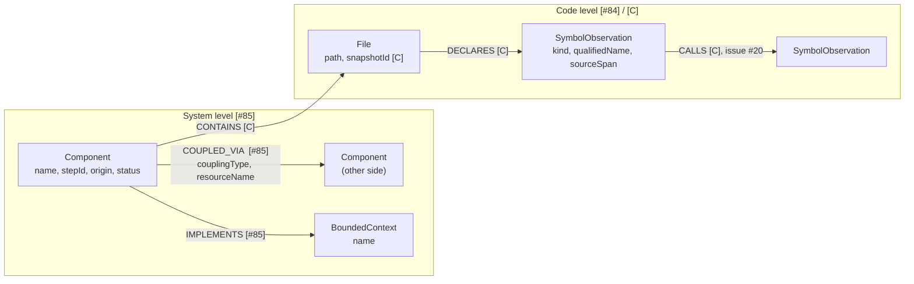

# Initial Graph Schema (Issue #21) – v1

Status: **v1**, implemented and tested; the open questions at the end are still open.
Neither PR #84 (issue #19) nor PR #85 (issue #23) is merged yet, so this code does **not** import from them; it only stays compatible.
Target store: PostgreSQL 17 + Apache AGE (Cypher).

Where the code is:

| What | Path |
|---|---|
| Node and edge models | `backend/app/graph_schema/models.py` |
| Rule checker (`validate_graph`, `assert_valid_graph`) | `backend/app/graph_schema/validator.py` |
| Mock step-05 → step-06 graph | `backend/app/graph_schema/mock_data.py` |
| Tests (24) | `backend/tests/test_graph_schema.py` |

The package is called `graph_schema`, not `graph`, because #85 will add `backend/app/graph/` and we avoid merge conflicts.

**Source tags** used in this document:

| Tag | Meaning |
|---|---|
| **[#84]** | taken from PR #84 (`SymbolObservation`, code level) |
| **[#85]** | taken from PR #85 (`GraphNode`, `GraphEdge`, queries, seed data) |
| **[C]** | taken from `architecture-contract.md` §3 |
| **[NEW]** | proposed here, not in any of the above |

## 1. Two levels in one graph

- **Code level** – what the parser sees: classes, methods, tables. Comes from #84 as `SymbolObservation` facts.
- **System level** – what the migration is about: components, bounded contexts, couplings, status. Comes from #85 (hand-seeded for now).

The two levels are joined by one idea: a `SymbolObservation` belongs to a `Component`.

## 2. Common properties

Every node has `id`, `label`, `name`. Everything else is in properties (#85 uses a free `properties` dictionary).

| Property | On | Meaning | Source |
|---|---|---|---|
| `id` | all nodes, all edges | unique string | [#85] (readable string) / [#84] (SHA-256 hash) |
| `name` | all nodes | short name | [#84] [#85] |
| `kind` | SymbolObservation | `class`, `interface`, `record`, `enum`, `method`, `constructor`, `table` (code also has `function`) | [#84] |
| `stepId` | system nodes, edges; **also code nodes that are linked to a Component** | migration step, e.g. `step-06` | [#85]; code nodes carrying it is **[NEW]** |
| `snapshotId` | code nodes (required), edges inside the code level | analysis snapshot (a hash in real data; readable like `snap-step-06` in the mock) | [#84] [C] |
| `commitSha` | code nodes (inside `sourceSpan`) | full commit of the source | [#84] [C] |
| `path` | code nodes | repo-relative file path | [#84] |
| `evidence` | most nodes, edges | list of `git:<repo>@<sha>:<path>#Lx-Ly` strings | [#84] [#85] [C] |

## 3. Node types

### System level

| Label | Required properties | Optional properties | Source |
|---|---|---|---|
| `Component` | `id`, `name`, `stepId`, `origin` (`legacy`/`target`), `status` | `description`, `port`, `evidence` | [#85]. The contract calls this `Module` (see open question 1). |
| `BoundedContext` | `id`, `name` | `description` | [#85] [C] |

`status` values: `active_legacy`, `in_development`, `live_target`, `decommissioned` [#85].

### Code level

| Label | Required properties | Optional properties | Source |
|---|---|---|---|
| `SymbolObservation` | `id` (= `observationId`), `snapshotId`, `repoId`, `path`, `kind`, `name`, `qualifiedName`, `sourceSpan` | `parentQualifiedName`, `signature`, `docstring`, `modifiers`, `metadata` | [#84] [C] |
| `File` | `id`, `repoId`, `path`, `snapshotId` | `language` | [C]. Not produced by #84 yet (see open question 6). |

`sourceSpan` = `repoId`, `commitSha`, `path`, `startLine`, `endLine` [#84].

Decision: classes, methods and tables stay **one** label with a `kind` property. The contract says not to split them into Class/Method nodes [C].

### Status fields on a symbol (taken from #85 seed data)

For decommission candidates, #85 puts these extra properties on a `SymbolObservation`: `stepId`, `component`, `status="decommissioned"`, `replacement`, `reason`, `risk` (`low`/`medium`/`high`). Kept in v1 so query 3 works; see open question 3.

## 4. Relationship types

| Type | From → To | Properties | Source |
|---|---|---|---|
| `IMPLEMENTS` | `Component` → `BoundedContext` | `stepId` | [#85] [C] |
| `COUPLED_VIA` | `Component` → `Component` | `stepId`, `couplingType` (`shared_database`, `messaging_topic`, `direct_http`, `shared_schema`), `resourceName`, `description`, `evidence` | [#85]. Not in the contract (see open question 4). |
| `CONTAINS` | `Component` → `File` | `snapshotId` | [C] |
| `DECLARES` | `File` → `SymbolObservation` | `snapshotId` | [C] |
| `CALLS` | `SymbolObservation` → `SymbolObservation` | `snapshotId`, `evidence` | [C]. Reserved for issue #20; not used yet. |

Every edge: `id`, `sourceId`, `targetId`, `relationshipType`, `properties` [#85].
`COUPLED_VIA` is directed (publisher → consumer, or reader → owner); direction is not checked today.

## 5. Rules

Rules 1 and 7 come from #85 / #84 / the contract. Rules 2–6 are **[NEW]**.
All rules are checked in code by `validate_graph()` (it lists every problem, not only the first). The rule names below are the strings it returns.

1. **Unique ids** (`duplicate-node-id`, `duplicate-edge-id`). A node `id` is unique in the whole graph; an edge `id` is unique among edges. (#85 silently replaces on duplicate.)
2. **Edges must point to existing nodes** (`missing-endpoint`). `sourceId` and `targetId` must both exist. (#85 does not check this.)
3. **Only allowed pairs** (`bad-endpoint-pair`). Source label → target label must match section 4, in that direction.
4. **Every node and every edge carries `stepId` or `snapshotId`** (`missing-scope`). `File` and `SymbolObservation` must carry a `snapshotId` (`code-node-needs-snapshot-id`). (#85 treats an edge without `stepId` as valid for every step.)
5. **Same scope** (`scope-mismatch`, `scope-unverifiable`).
   - Compare `stepId` only if both ends have one; compare `snapshotId` only if both have one; the edge's own scope must agree with both ends.
   - If the two ends share **no** comparable key, the edge is **rejected** as `scope-unverifiable`, not silently accepted. This is why a `File` linked to a `Component` must carry **both** `snapshotId` and `stepId`.
6. **Symbol id is the hash** (`bad-observation-id`). `id = sha256(snapshotId:repoId:path:kind:qualifiedName)` [#84] [C]. Never use the short name alone [C].

Shape checks done by the models themselves: unknown edge type, unknown `kind`, unknown extra fields, and a `COUPLED_VIA` without `couplingType` + `resourceName` are all errors.

## 5a. Differences from #85 (kept compatible, but not identical)

| Topic | #85 | v1 here |
|---|---|---|
| Node classes | one generic `GraphNode` with a property bag | typed classes per label; `to_record()` gives the #85 shape `{id, label, name, properties}` |
| Symbol → Component link | text property `component` | graph path `Component -CONTAINS-> File -DECLARES-> SymbolObservation` (the property is not kept) |
| Symbol ids | readable (`symbol:monolith:CategoryResource:step-06`) | SHA-256 hash (#84 formula) |
| Edge scope | `stepId` optional (missing = every step) | `stepId` or `snapshotId` required |
| Edge endpoints | not checked | must exist, must be an allowed pair |
| Decommission info | properties on the symbol | same (`status`, `replacement`, `reason`, `risk` stay on the node) |
| Symbol `kind` | free text; `endpoint`/`database_table` appear in decommission kinds | the 7 kinds from #84 only |
| `File` nodes | none | added (from the contract) |
| Bounded contexts | one node, `IMPLEMENTS` edge has `stepId` | one node **per step** (so the same-scope rule works) |

## 5b. Mock data

`mock_data.build_mock_graph()` returns 11 nodes and 9 edges:

- step-05: `monolith` + `bc:catalog:step-05`.
- step-06: `monolith`, `catalog-service`, `bc:catalog:step-06`, 2 files, 4 symbols (the monolith `CategoryResource` is `decommissioned`), and one `COUPLED_VIA` for the Kafka topic `product-price-updated`.
- File paths, line numbers and commit ids are illustrative, **not** read from the reference repositories.
- Snapshot ids are readable mock ids (`snap-step-06`), not real hashes. One snapshot per step is assumed (see open question 16).

## 6. The 4 queries from #85

| Query | Nodes used | Edges used | Properties filtered |
|---|---|---|---|
| Migration status (`get_migration_status`) | `Component`, `BoundedContext`; also counts any node with `status=decommissioned` | `IMPLEMENTS` | `stepId`, `name`, `origin`, `status` |
| Coupling (`get_coupled_components`) | `Component` (for names) | `COUPLED_VIA` | edge `stepId`, `couplingType`, `resourceName` |
| Decommission candidates (`get_decommission_candidates`) | any node with `status=decommissioned` (today: `SymbolObservation`) | none | `stepId`, `status`, `kind`, `component`, `replacement`, `reason`, `risk` |
| Component symbols (`get_component_symbols`) | `SymbolObservation` | none (uses the `component` property, not an edge) | `stepId`, `component`, `kind` |

Note: query 4 finds symbols by a text property `component`. With the contract path it would be `Component -CONTAINS-> File -DECLARES-> SymbolObservation` (see open question 2).

## 7. Diagram

## 8. Open questions

1. **Component vs Module.** #85 uses `Component`; the contract uses `Module`. Which name do we keep? Also, #85 makes one component node per step (`comp:monolith:step-06`), while the contract wants a stable identity with the step as a membership.
2. **How is a symbol linked to a component?** #85 uses a text property `component="monolith"`. The contract uses `Module CONTAINS File DECLARES SymbolObservation`. #84 only knows `repoId` (e.g. `legacy-example-monolith`), not the component name. We need a mapping `repoId` → component.
3. **Where does "decommissioned" live?** #85 stores `status`, `reason`, `risk` on the symbol. The contract has a separate `MigrationStatus` node with `STATUS_OF`, rule/version and evidence, and says a code diff must not imply `RETIRED`. Do we move to `MigrationStatus` nodes? Also `replacement` is a text like `"catalog-service:CategoryResource"`; should it become a `REPLACED_BY` edge **[NEW]**?
4. **`COUPLED_VIA` is not in the contract.** The contract has `MessagingRoute` nodes with `PUBLISHES/SUBSCRIBES`, and `DeploymentNode STORES` for tables. #85 hides the Kafka topic and the Db2 column inside edge properties. Keep as is for v1, or add `MessagingRoute` nodes?
5. **`stepId` vs `snapshotId`.** #85 stamps `stepId` on nodes. The contract says a step is not a commit/snapshot, and observations must not carry one exclusive step; steps connect to snapshots through the manifest (`members[]`). We need a `Step`/`Snapshot` node or a lookup, and a rule how `step-06` maps to snapshot hashes.
6. **`File` and `Module` facts.** The contract has them and `FactRecord.recordType` allows `File`/`Module`, but #84 only creates `SymbolObservation`. Who creates `File` nodes and `DECLARES` edges?
7. **Id style.** #84 ids are SHA-256 hashes; #85 seed ids are readable (`symbol:monolith:CategoryResource:step-06`). They cannot both be a `SymbolObservation` id. Seed data would need real `observationId`s.
8. **Seed symbols are incomplete.** The #85 seed `SymbolObservation` nodes miss `observationId`, `repoId`, `path`, `qualifiedName`, `sourceSpan`.
9. **Kind lists differ.** #84 code allows `function` (the PR text lists 7 kinds without it). #85's decommission `kind` allows `component`, `class`, `endpoint`, `database_table`; `endpoint` and `database_table` are not `SymbolObservation` kinds (`table` is).
10. **Label vs kind.** #85 `GraphNode.label` is the node type (`Component`, `SymbolObservation`). In AGE this becomes the vertex label. Confirm that we use `label` = type and `kind` = sub-type only for symbols.
11. **Competing research doc.** Branch `77-define-initial-graph-schema` has `Documentation/graph-schema/initial-schema-research.md`. It proposes `Project`, `Snapshot`, `ComponentState`, `CodeGraph`, separate `Class`/`Interface`/`Method` nodes, and Neo4j. This conflicts with the contract (one `SymbolObservation`, PostgreSQL + AGE). Do we merge ideas (`Snapshot`, `ComponentState`) or follow the contract?
12. **Cross-step identity.** Is `monolith@step-05` the same entity as `monolith@step-06`? Contract: only through `SAME_ENTITY_AS` with explicit evidence. Not in v1.
13. **AGE specifics not checked.** One vertex label per node, free-form property map, no schema enforcement. So the rules in section 5 must be enforced by our loader code, not by the database. Indexes are not designed.
14. **#20 not merged.** `CALLS` and other code relations are only reserved here (allowed pair exists, no mock data, no tests beyond the pair table).
15. **One node per step.** v1 follows #85: `Component` and `BoundedContext` are copied per step (`comp:monolith:step-05`, `comp:monolith:step-06`). The contract wants one stable identity with the step as a membership. Same question as 1 and 12.
16. **Step and snapshot are mixed.** v1 puts both `stepId` and `snapshotId` on code nodes so the same-scope rule can run. The mock assumes one snapshot per step. The contract says one snapshot can be used by several steps, so `stepId` on a code node would then be wrong. Needs a real `Step` ↔ `Snapshot` link (see question 5).
17. **Who adds `stepId` to code nodes?** #84 facts only have `snapshotId`. The loader would have to add `stepId` from the manifest, otherwise `Component -CONTAINS-> File` is rejected as `scope-unverifiable`.
18. **Kinds left out.** `function` (in #84 code) is not allowed in v1, because the decision list has 7 kinds. #85's text property `component` on symbols is dropped (replaced by the graph path). Confirm both with the #84 / #85 authors.

### v1 decisions that answer part of the questions above

- Q1: v1 keeps the name `Component`.
- Q2: v1 uses the contract path (`CONTAINS` + `DECLARES`). The `repoId` → component mapping is **still open**: the mock simply uses the same text for `repoId` and component name.
- Q3: v1 keeps decommission info as properties on the node.
- Q4: v1 keeps `COUPLED_VIA` with the topic in the edge properties.
