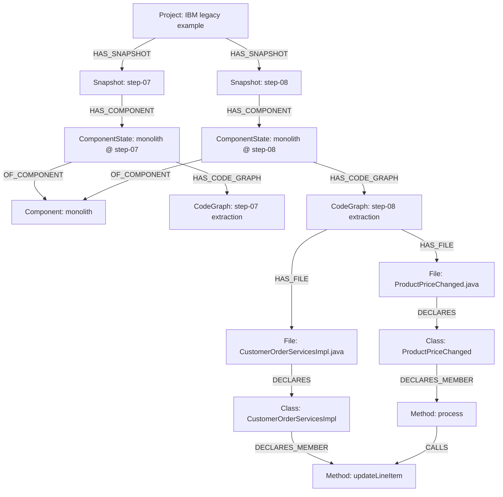
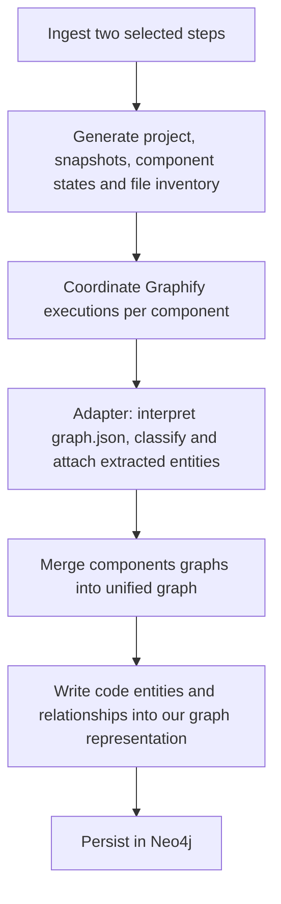

# Research: Initial Knowledge Graph Schema 

This document summarizes an investigation into a possible initial graph schema and code-ingestion architecture. It is intended to align terminology and knowledge before implementation. Criticism, alternatives and improvements are welcome and encouraged.


## Table of Contents

- [1. Scope](#1-scope)
- [2. Proposed Graph Schema](#2-proposed-graph-schema)
  - [2.1 Nodes](#21-nodes)
  - [2.2 Relationships](#22-relationships)
  - [2.3 Ownership and file matching](#23-ownership-and-file-matching)
  - [2.4 Snapshot boundaries](#24-snapshot-boundaries)
  - [2.5 Graph Schema](#25-graph-schema)
- [3. What Is Already Implemented](#3-what-is-already-implemented)
- [4. Suggested Architecture](#4-suggested-architecture)
- [5. Graphify](#5-graphify)
  - [5.1 Role and licensing](#51-role-and-licensing)
  - [5.2 Reusing the output](#52-reusing-the-output)
  - [5.3 Entity classification problem](#53-entity-classification-problem)
  - [5.4 Adapter and extractor options](#54-adapter-and-extractor-options)
  - [5.5 Scope and merging](#55-scope-and-merging)
- [6. Limitations and Open Questions](#6-limitations-and-open-questions)

## 1. Scope

The immediate objective is to define a graph for representing and storing legacy and target **source-code**, initially representing **two** distinct steps of the reference system’s modernization (Ex.: step-07 and step-08).

The graph should organize:

- Modernization snapshots(steps) and their components.
- Project metadata
- Metadata of each component in snapshot.
- Files and the code entities (mehtods, classes, imports, etc) extracted from them.
- Structural relationships and static dependencies (imports, calls, references) between these entities.

From the sources proposed by `legacy-example-stages/QUESTIONS.md`, this schema is meant for providing information regarding **T** and **L**.

Later work should enrich and adapt the schema to include domain knowledge, migration processes, coupling data, startup scripts, routing, deployment configuration and other sources (**D** and **P**). 

## 2. Proposed Graph Schema


The sources where we are going to extract information from are better described in further sections:

Ingestor refers to the already implemented code-ingestor:[Section 3 — What Is Already Implemented](#3-what-is-already-implemented)

Graphify adapter and extractor extension: [Section 4 — Suggested Architecture](#4-suggested-architecture) and [Section 5 — Graphify](#5-graphify)


### 2.1 Nodes

Suggested nodes for the graph

| Node | Meaning | Suggested key properties | Information source |
|---|---|---|---|
| `Project` | The system being analyzed | `id`, `name` | User input/configuration |
| `Snapshot` | A selected state of the complete reference system | `id`, `label`, `commitSha` | User input, `legacy-example-stages/stage.json`, ingestor/Git metadata |
| `Component` | Component identity across snapshots | `id`, `key`, `repo` | `legacy-example-stages/stage.json`, repository metadata, user input |
| `ComponentState` | Component occurrence in one step | `id`, `commitSha`, `migrationRole` | ingestor output `sources.jsonl` ; user input |
| `CodeGraph` | Attachment point for a component’s extraction result | `id`, `runId`, `graphifyVersion` | Created by our pipeline |
| `File` | A selected source file in a component state | `id`, `path`, `contentHash` | Ingestor's output `sources.jsonl` reconciled with Graphify file nodes |
| `Class` | A class declaration within a snapshot | `id`, `name`, `ownerComponentStateId` | Graphify; precise classification may require additional evidence or an extractor extension |
| `Interface` | An interface declaration within a snapshot | `id`, `name`, `ownerComponentStateId` | Graphify; precise classification may require additional evidence or an extractor extension |
| `Method` | A method declared by a type | `id`, `name`, `ownerComponentStateId` | Graphify plus adapter; distinguishing methods from constructors may require an extractor extension |
| `Function` | A function declaration outside a type | `id`, `name`, `ownerComponentStateId` | Graphify callable and structural information, interpreted by the adapter |
| `CodeEntity` | Fallback for an extracted entity whose precise kind is not established | `id`, `name`, `kind`, `ownerComponentStateId` | Graphify plus adapter classification |
| `ExternalSymbol` | A reference to a symbol outside the locally extracted declarations | `id`, `name` | Graphify external/unresolved-symbol information |

A `Component` represents a stable component identity, such as `monolith`.

A `ComponentState` represents that component within a particular snapshot/step. Its source code/status/dependencies may differ between snapshots.

The suggested `ComponentState.migrationRole` values are:

```text
legacy | target | transition | unknown
```

This classification is separate from technical categories such as frontend, backend or database. Weather this will be taken as input from user or inferred based on some set of rules is still unclear.


### 2.2 Relationships

Suggestions of types of edges in the graph


| Relationship | Source → target | Meaning | Information source |
|---|---|---|---|
| `HAS_SNAPSHOT` | `Project` → `Snapshot` | Snapshot belongs to the project | User selection and integration layer |
| `HAS_BASELINE` | `Project` → `Snapshot` | Pinned version of project | User input |
| `HAS_COMPONENT` | `Snapshot` → `ComponentState` | Component participates in the snapshot | `legacy-example-stages/stage.json` and ingestor |
| `OF_COMPONENT` | `ComponentState` → `Component` | Connects an occurrence to its stable identity | Manifest key and integration mapping |
| `HAS_CODE_GRAPH` | `ComponentState` → `CodeGraph` | Associates the extraction with its component occurrence | Integration layer |
| `HAS_FILE` | `CodeGraph` → `File` | Associates selected files with the extraction scope | Ingestor and orchestration |
| `DECLARES` | `File` → `CodeEntity` | File declares a type or top-level callable | Graphify structure interpreted by the adapter |
| `DECLARES` | `File` → `Class` / `Interface` / `Function` / `CodeEntity` | File declares a type, top-level function or otherwise unclassified entity | Graphify structure interpreted by the adapter |
| `DECLARES_MEMBER` | `Class` / `Interface` → `Method` | Type declares a method; classes may also declare constructors | Graphify `method` relationship plus precise kind classification |
| `CONTAINS_TYPE` | `Class` / `Interface` → `Class` / `Interface` | Nested type belongs to an enclosing type | Graphify containment plus precise kind classification |
| `CALLS` | `File` / `Class` / `Method` / `Function` / `CodeEntity` → `Method` / `Function` / `Class` / `CodeEntity` / `ExternalSymbol` | Static invocation, including top-level calls and constructor invocations | Graphify |
| `EXTENDS` | `Class` → `Class`; `Interface` → `Interface`; target may instead be `ExternalSymbol` | Class inheritance or interface extension | Graphify `inherits` plus precise kind classification |
| `IMPLEMENTS` | `Class` → `Interface` / `ExternalSymbol` | Class implements an interface | Graphify `implements` plus precise kind classification |
| `REFERENCES` | Any code-entity kind → any code-entity kind / `ExternalSymbol` | Other symbol or type reference | Graphify |
| `IMPORTS` | `File` → `File` / `Class` / `Interface` / `Function` / `CodeEntity` / `ExternalSymbol` | Import relationship, retaining its available resolution | Graphify |
| `DERIVED_FROM` | `Snapshot` → `Snapshot` | Optional logical snapshot lineage | User input or explicit stage-history mapping |
| `SOURCED_FROM` | Any code-entity kind → `File` | Optional source-provenance attachment | Graphify `source_file` plus ingestor matching |

These relationship names describe intended meanings. The exact mapping of every Graphify relationship remains to be validated.

A separate inverse `PART_OF` relationship is not required wherever an existing relationship already expresses containment. Queries can traverse the relationship in either direction.

### 2.3 Ownership and file matching

Graphify already emits file nodes for many analyzed files. However, its output is not a complete inventory of selected files: unsupported or skipped files can produce no node.

The ingestor `sources.jsonl` should therefore establish the selected-file inventory. Graphify file nodes are reconciled with that inventory rather than imported as duplicate files.

Matching should use:

```text
snapshot + component/repository + normalized relative path
```

A filename or relative path alone is insufficient because different components can contain identical paths.


### 2.4 Snapshot boundaries

Each component state and locally extracted code entity belongs to one snapshot.

Calls, imports and other system dependencies must connect entities **within that same snapshot**. Historical relationships such as snapshot lineage are separate from code dependencies.

Identifiers must be scoped accordingly. A Graphify ID is not, by itself, a stable identity across snapshots.

### 2.5 Graph Schema



## 3. What Is Already Implemented

A reference-source ingestor and experimental Graphify pipeline already exist.

Relevant locations in `amos2026ws01-legacy-migrator`:

| Path | Purpose |
|---|---|
| `Documentation/ingestion/reference-loader.md` | Ingestor setup, configuration and JSONL format |
| `backend/code-ingestion-pipeline/README.md` | Prototype graph-generation workflow |
| `backend/code-ingestion-pipeline/run_pipeline.py` | Orchestrates loading, source reconstruction and Graphify |
| `backend/code-ingestion-pipeline/src/migration_assistant/` | Ingestor implementation |
| `backend/code-ingestion-pipeline/.cache/ingestion/<run>/graphs/` | Locally generated graph artifacts |

The prototype can generate combined or per-component graphs. Its combined mode currently means a broad extraction over multiple components, and does not work well. Dependencies are lost and the graph is too confusing to be reused.

This is an exploratory prototype for inspecting Graphify’s behavior and outputs. The proposed production implementation would reuse the ingestor while substantially changing graph orchestration, assembly and persistence.


## 4. Suggested Architecture



1. **Ingestion:** resolve selected steps and pinned component revisions; produce `sources.jsonl` (already implemented).
2. **Context generation:** create nodes based on user input, `stage.json`, Git metadata and `sources.jsonl`.
3. **Extraction orchestration:** execute Graphify within selected component/build boundaries, preserving scope and version metadata.
4. **Adaptation:** interpret the merged output, reconcile files, classify entities and map relationships.
5. **Merge:** use Graphify’s merger or develop new approach to combine component outputs for each snapshot separately.
6. **Graph assembly:** attach normalized code facts to the corresponding component states.
7. **Persistence:** write the assembled model to Neo4j.

Extractor changes may be considered during orchestration when required facts are absent from Graphify’s output. They would complement the integration layer, as discussed below.

## 5. Graphify

References: [Graphify documentation](https://docs.graphify.com/) · [Graphify GitHub repository](https://github.com/Graphify-Labs/graphify).

### 5.1 Role and licensing

Graphify is an existing code-to-graph tool providing a CLI and Python library. Its use has been approved by the industry partner. 

The open-source project is distributed under Apache-2.0. Its notice retains MIT licensing information for earlier contributions. See the upstream [LICENSE](https://github.com/Graphify-Labs/graphify/blob/v8/LICENSE) and [NOTICE](https://github.com/Graphify-Labs/graphify/blob/v8/NOTICE).

The inspected prototype pins `graphifyy==0.9.100`. Observations in this document concern that version, not a guarantee about every release.

### 5.2 Reusing the output

Graphify’s extracted structural facts should supply our code subgraph. They do not need to remain an unrelated graph queried separately.

However, its raw schema does not contain our project/snapshot/component model or consistently expose precise language-level entity kinds. Reusing its facts therefore involves normalization and attachment to our context.

The persisted format follows NetworkX node-link conventions, with fields varying by extractor and version. See [Graph files and outputs](https://docs.graphify.com/concepts/outputs).


### 5.3 Entity classification problem

In the inspected output:

```text
File
    file_type = code

Class-like declaration
    file_type = code
    _callable = true
    _callable_class = true

Member callable
    file_type = code
    _callable = true
```

Structural relationships provide additional evidence:


These signals allow useful categories, but not all precise distinctions:

- `_callable_class` covers Java classes, interfaces, records, enums and annotation declarations.
- `_callable` also applies to class-like declarations; it does not mean “method.”
- Java `method` relationships include methods and constructors.

Consequently, a way of distinguishing between Classes and Interfaces as well as Methods and Constructors is still needed.

### 5.4 Adapter and extractor options

- **Adapter:** code we write after Graphify to translate `graph.json` into our schema and attach entities to components and snapshots. It cannot recover information missing from the output.
- **Extractor change:** modify Graphify’s internal code to output additional facts, for example, whether a declaration is a class or an interface. 


| Approach | Description | Tradeoff |
|---|---|---|
| **Adapter** | Interpret flags and relationships already present in `graph.json` | Keeps upstream unchanged, but cannot recover omitted facts |
| **Extractor change** | Preserve additional parser-known facts, such as `astKind` | Gives more precise information but introduces maintenance and validation work |

A **hybrid approach** uses small extractor changes for missing facts and an adapter for integration with our schema.


### 5.5 Scope and merging 

How to merge the Graphify's output of each component into a singles connected graph?

The current direction is to use Graphify’s native merger. It namespaces ordinary local entities by repository and can attempt additional cross-repository resolution. External symbols may be shared. See [Multiple repositories](https://docs.graphify.com/open-source/features/multi-repo).

We can also decide to implement our own merger or adapt this one, in case it proves insufficient.


## 6. Limitations and Open Questions

- **Neo4j query optimization has not been designed.** Labels, indexes, relationship directions, cardinalities and storage costs require validation against actual queries.
- **Tool coverage remains only partially understood.** We have investigated examples, not established complete extraction accuracy for the reference system.
- **The schema is not yet proven implementable end to end.** Some relationships and precise code-entity kinds remain conditional on extraction capabilities.
- **Domain and process integration has not been researched sufficiently.** Future models may require significant schema changes.
- **Unsupported files remain unresolved analytically.** File nodes can record their existence, but interpreting nginx, deployment scripts and other unsupported inputs needs additional work.
- **Cross-snapshot code identity is unresolved.** Matching classes and methods through renames, moves and overloads is not supplied by Graphify.
- **Runtime migration status cannot be inferred from presence alone.** Included, reachable, deployed, replaced and decommissioned are different facts.
- **arc42 generation remains an open design topic.** This graph is a possible foundation, but the required projections, enrichment and deterministic rendering rules are not established.

`QUESTIONS.md` and the reference system’s architecture examples should guide these investigations rather than be treated as capabilities already delivered.
