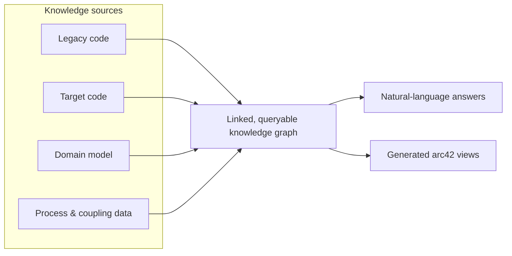

# Industry Partner Kickoff

**AI-Assisted Legacy Migration Knowledge Base**

*AMOS · Winter Semester 2026/27 · iteratec*

> [!IMPORTANT]
> **Discussion draft — for team review**
>
> This document supports kickoff preparation. It is **not** an approved requirements specification, implementation plan, or commitment to a release scope. Decisions must be confirmed with the Industry Partner and the team.

| Project information | Details |
| :--- | :--- |
| **Industry Partner** | iteratec |
| **Industry Contact** | Wolfgang Strunk |
| **Course** | AMOS — Winter Semester 2026/27 |
| **Kickoff date** | To be confirmed |
| **Document status** | Draft · awaiting team review |

**Navigate:** [Kickoff objectives](#1-kickoff-objectives) · [Product overview](#2-product-overview) · [Discussion questions](#3-kickoff-discussion-guide) · [Weeks 1–2](#4-candidate-work-packages) · [Open decisions & risks](#5-open-decisions-and-risks) · [Meeting notes](#6-meeting-notes) · [Decision log](#7-decision-log) · [Action tracker](#8-action-tracker) · [Follow-up](#9-follow-up-after-the-kickoff)

---

## 1. Kickoff objectives

**Meeting purpose:** Establish a shared understanding of the proposed product and turn the unresolved points in iteratec's *Project Sketch* into an actionable starting plan.

### Outcomes to aim for

| Focus | Desired outcome |
| :--- | :--- |
| **Product direction** | Shared Product Goal and realistic, observable success criteria |
| **Delivery scope** | Agreed expectations for the first demonstrable increment and mid-project release |
| **Reference scenario** | Direction for a synthetic example and the initial two weeks of work |
| **Technical exploration** | Clear questions and evaluation criteria, without premature technology commitments |
| **Ways of working** | Clarified responsibilities, feedback process, and next checkpoint |

> [!NOTE]
> The goal is to **identify and record agreements**, not to finalize every technical detail in the first meeting.

---

## 2. Product overview

### 2.1 Proposed Product Goal

> Build a prototype knowledge base for **legacy-to-target software migration** that connects knowledge of the legacy system, target system, business domain, and migration/coupling status in **one queryable graph**. Make this knowledge accessible through **natural-language queries** and **automatically generated architecture views**.

This interpretation is based on the *Project Sketch* and should be refined with iteratec.

**Primary value:** Persistent, cross-referenced system understanding and visibility into migration status.

**Not the goal:** Automatic code migration or a general-purpose project assistant.

### 2.2 Knowledge sources

The proposed graph brings together four kinds of information:

| Knowledge source | What it represents | Example inputs |
| :--- | :--- | :--- |
| **01 · Legacy code** | Existing components, calls, and data access | Legacy source code; structural analysis |
| **02 · Target code** | Components actually implemented in the new system | Target source code analyzed through the same pipeline |
| **03 · Domain model** | Bounded contexts, business rules, events, and domain language | Event Storming outputs; product/domain documentation |
| **04 · Process & coupling data** | Migration/deployment status and remaining dependencies | Work items; architecture decisions; shared tables; messaging routes |

The domain model should be linked to **both** codebases so that the graph can show which implementation supports a given bounded context in the legacy and target systems.

#### Conceptual information flow

*Conceptual illustration only — not a selected graph technology, data pipeline, or approved system architecture.*

### 2.3 Expected demonstration capabilities

#### Natural-language queries

A worked example should make it possible to investigate questions such as:

1. Which parts of the legacy system have already been **decommissioned**?
2. What is **implemented or under development** in the target system?
3. Which **dependencies or couplings** still connect the two systems?
4. Based on available evidence, what could reasonably be **decommissioned next**?

#### Automatically generated architecture documentation

The *Project Sketch* calls for three **arc42 views generated from the current graph**, rather than diagrams maintained separately by hand.

| arc42 view | Intended content |
| :--- | :--- |
| **Context View** | External actors, neighboring systems, and interfaces |
| **Building Block View** | Legacy/target components and their status |
| **Deployment View** | Runtime topology and relevant connections |

**To define and validate:** How output correctness is assessed and how changes in the graph are reflected in generated answers and views.

### 2.4 Scope boundaries and assumptions

| Area | Current understanding from the Project Sketch |
| :--- | :--- |
| **Reference data** | Use a synthetic or suitably adapted open-source legacy/target example; **no confidential client systems or data**. |
| **Previous prototype** | The 2025 iteratec internal prototype is prior-art inspiration; this project is a **fresh build**, not a fork or extension of that codebase. |
| **Tooling approach** | Survey open-source code-analysis and code-to-graph options first; document a **build vs. adopt vs. adapt** recommendation in weeks 1–2. |
| **MVP depth** | A narrow end-to-end vertical slice is proposed, but **narrow/deep versus broad/shallow remains open**. |
| **Technical context** | Python/JavaScript, relevant libraries, and university HPC resources appear in the brief; access and architecture still need confirmation. |

> [!CAUTION]
> The architecture concept and nine-person technical-team proposal in the *Project Sketch* are **not** an agreed delivery structure. They do not supersede the actual AMOS team setup or Scrum roles.

---

## 3. Kickoff discussion guide

Use the questions below to drive decisions and reveal uncertainties. They are **discussion prompts, not a mandatory script**.

### A. Product Goal, MVP & evaluation

1. **Minimum demonstration:** What would iteratec consider the minimum successful end-to-end demonstration for this semester?
2. **Primary users and decisions:** Who will use the prototype, and what concrete migration decisions should it help them make?
3. **Scope strategy:** Should we start with the proposed **narrow vertical slice**, or aim for broader coverage of the four knowledge sources?
4. **Success criteria:** Which observable results and acceptance criteria matter most for the **mid-project release** and **Demo Day**?

### B. Synthetic reference scenario

5. **Scenario selection:** Who should select or design the synthetic legacy/target system pair? Which domain, language, scale, and migration history would make it convincing?
6. **Representative migration state:** Which migration stages and remaining dependencies must the example contain to support meaningful decommissioning questions?

### C. Technical options to investigate

7. **Open-source survey:** What deliverable is expected from the weeks 1–2 tooling survey? Which prior-art references will iteratec provide?
8. **Technology evaluation:** Which criteria should guide the choice of graph store, extraction tooling, and LLM approach — for example, accuracy, cost, maintainability, and available infrastructure?
9. **Process integrations:** Is a **mocked/synthetic integration** sufficient, or should the prototype connect to a live Jira/GitLab or messaging instance?
10. **Query experience:** Should the initial interface be **chat, MCP, or both**?
11. **arc42 output:** Which rendering format is expected, and how should the team verify that each view stays consistent with changes in the graph?

### D. Collaboration & delivery

12. **Feedback and validation:** How frequently should the team get feedback, and who will validate product requirements and working demonstrations?
13. **Team coordination:** How should the proposed technical subteams and integration lead relate to the actual AMOS team, Product Owner(s), and Scrum Master?
14. **Product naming:** Is a distinct product name needed now, or can the current project title remain a working title?

> [!TIP]
> **Facilitation:** Product Owners should steer discussion toward **value, scope, priorities, and acceptance criteria**. Developers should lead the assessment of **technical feasibility and implementation options**.

---

## 4. Candidate work packages

The items below are **proposals based on the Project Sketch**. They are **not** committed Sprint Backlog items, confirmed assignments, or final deadlines.

| Proposed work package | Expected output | Ownership / coordination |
| :--- | :--- | :--- |
| **Reference scenario** | Synthetic legacy/target system with a credible migration history | To agree with the team |
| **Open-source tooling survey** | Concise **build / adopt / adapt** comparison and recommendation | To agree with developers |
| **Initial success criteria** | Defined demonstration scope and observable acceptance criteria | PO(s), team, and partner — to agree |
| **Interfaces & milestones** | Mapped dependencies, coordination checkpoints, and course deliverables | Entire team — to agree |

> [!NOTE]
> Before committing this work to a Sprint, check the **AMOS weekly Sprint/Homework deadlines** and align the proposed two-week activities with course requirements.

---

## 5. Open decisions and risks

### 5.1 Decisions still to be made

| Topic | Current position | Next step |
| :--- | :--- | :--- |
| **MVP coverage** | Narrow-first proposed; breadth vs. depth unresolved | Agree scope and success criteria at kickoff |
| **Synthetic reference system** | Synthetic example required; design not selected | Agree on example and ownership |
| **Code-analysis tooling** | Survey required; no tool selected | Define build / adopt / adapt evaluation |
| **Graph & LLM stack** | Architecture and cost implications unresolved | Set evaluation criteria |
| **Process/coupling integration** | Mocked vs. live integration undecided | Agree required integration depth |
| **Query interface** | Chat vs. MCP vs. both undecided | Agree initial user flow |
| **arc42 generation** | Three view types identified; format undecided | Agree rendering and validation approach |

### 5.2 Delivery and quality risks

| Risk | Why it matters | Suggested mitigation to discuss |
| :--- | :--- | :--- |
| **Subteam integration** | Shared schema or interfaces could diverge | Agree integration checkpoints |
| **Unsupported LLM answers** | Explanations may be inaccurate or lack evidence | Define validation and human review |

> [!WARNING]
> **Public repository / information handling:** Do **not** publish iteratec-internal source code, proprietary documents, or access details in this public GitHub repository without explicit permission — even if the project brief states that no NDA is required.

---

## 6. Meeting notes

| Meeting detail | Entry |
| :--- | :--- |
| **Date** | To be confirmed |
| **Participants** | To be confirmed |
| **Note-taker** | To be confirmed |

### Discussion summary

*Add key discussion points during the meeting.*

### Confirmed requirements & success criteria

*Record only requirements and criteria explicitly agreed with the Industry Partner and team.*

### Unresolved questions

*Capture remaining questions and any follow-up needed.*

---

## 7. Decision log

Record **confirmed decisions only**, including who agreed and the supporting rationale. Keep undecided options in [Section 5](#5-open-decisions-and-risks).

| Confirmed decision | Rationale / evidence | Agreed by | Date |
| :--- | :--- | :--- | :--- |
| *Pending kickoff* | — | — | — |

---

## 8. Action tracker

Track agreed next steps here. Do not interpret a proposed work package as an assignment until ownership is confirmed.

| Action / deliverable | Owner | Due date | Status |
| :--- | :--- | :--- | :--- |
| *Pending kickoff* | To be assigned | To be agreed | Open |

---

## 9. Follow-up after the kickoff

1. **Document decisions:** Circulate the agreed scope, success criteria, and confirmed decisions.
2. **Confirm responsibilities:** Assign owners and deliverables for the reference scenario and open-source survey.
3. **Shape the Product Backlog:** Convert validated needs into initial backlog items with acceptance criteria.
4. **Check feasibility:** Review dependencies and technical feasibility with developers; prioritize collaboratively.
5. **Align the next Sprint:** Agree on the next Sprint Goal and checkpoint within AMOS course requirements.

---

**Preparation sources:** iteratec, *AI-Assisted Legacy Migration Knowledge Base — Project Sketch* (9 pages); AMOS Project Information sheet.

**Document control:** Discussion draft. Technologies, scope, assignments, success criteria, and release commitments remain subject to team agreement.
