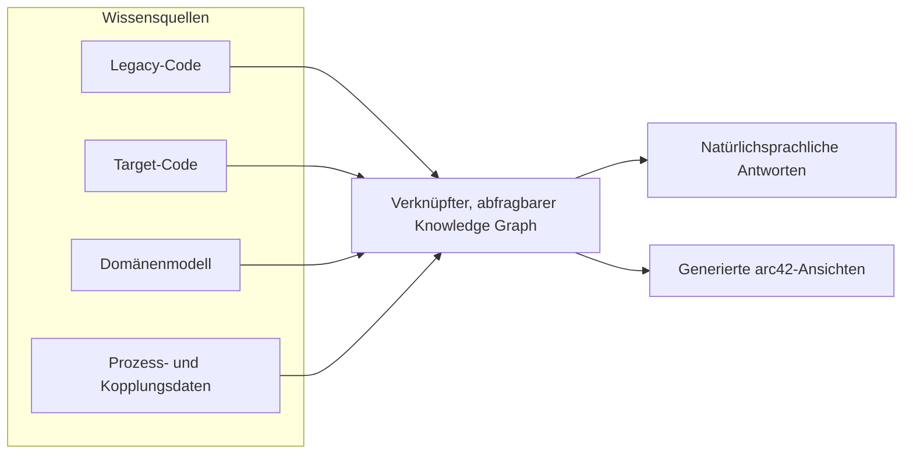

# Kickoff mit dem Industriepartner

**Sprache / Language:** **Deutsch** (aktuell) · [English](industry-partner-kickoff.en.md)

**AI-Assisted Legacy Migration Knowledge Base**

*AMOS · Wintersemester 2026/27 · iteratec*

> [!IMPORTANT]
> **Diskussionsentwurf – zur Abstimmung im Team**
>
> Dieses Dokument dient der Vorbereitung des Kickoff-Meetings. Es ist **weder eine freigegebene Anforderungsspezifikation noch ein verbindlicher Implementierungsplan oder eine Zusage zum Lieferumfang**. Entscheidungen werden erst nach Abstimmung mit dem Industriepartner und dem Team als verbindlich festgehalten.

| Projektinformationen | Angaben |
| :--- | :--- |
| **Industriepartner** | iteratec |
| **Ansprechpartner** | Wolfgang Strunk |
| **Lehrveranstaltung** | AMOS – Wintersemester 2026/27 |
| **Kickoff-Termin** | Noch zu bestätigen |
| **Dokumentenstatus** | Entwurf · Team-Review ausstehend |

**Navigation:** [Kickoff-Ziele](#1-ziele-des-kickoffs) · [Produktüberblick](#2-produktüberblick) · [Diskussionsleitfaden](#3-diskussionsleitfaden-für-den-kickoff) · [Wochen 1–2](#4-mögliche-arbeitspakete) · [Offene Entscheidungen & Risiken](#5-offene-entscheidungen-und-risiken) · [Besprechungsnotizen](#6-besprechungsnotizen) · [Entscheidungsprotokoll](#7-entscheidungsprotokoll) · [Maßnahmenübersicht](#8-maßnahmenübersicht) · [Nachbereitung](#9-nachbereitung-des-kickoffs)

---

## 1. Ziele des Kickoffs

**Zweck des Meetings:** Ein gemeinsames Verständnis des geplanten Produkts schaffen und die im *Project Sketch* von iteratec bewusst offengelassenen Punkte in einen umsetzbaren Ausgangsplan überführen.

### Angestrebte Ergebnisse

| Schwerpunkt | Angestrebtes Ergebnis |
| :--- | :--- |
| **Produktausrichtung** | Gemeinsames Product Goal und realistische, überprüfbare Erfolgskriterien |
| **Lieferumfang** | Abgestimmte Erwartungen an das erste vorführbare Inkrement und das Mid-Project Release |
| **Referenzszenario** | Grundsätzliche Richtung für ein synthetisches Beispielszenario und die Arbeit der ersten zwei Wochen |
| **Technische Voruntersuchung** | Klare Fragestellungen und Bewertungskriterien, ohne Technologien vorschnell festzulegen |
| **Zusammenarbeit** | Geklärte Zuständigkeiten, Feedbackwege und nächster Abstimmungstermin |

> [!NOTE]
> Ziel ist es, **Vereinbarungen zu erarbeiten und zu dokumentieren** – nicht, bereits im ersten Meeting sämtliche technischen Details endgültig festzulegen.

---

## 2. Produktüberblick

### 2.1 Vorgeschlagenes Product Goal

> Entwicklung einer prototypischen Wissensbasis für die **Migration von Legacy- zu Zielsystemen**. Wissen über das Altsystem, das Zielsystem, die fachliche Domäne sowie den Migrationsstatus und bestehende Kopplungen soll in **einem gemeinsam abfragbaren Knowledge Graph** verknüpft werden. Das Wissen soll über **natürlichsprachliche Abfragen** und **automatisch erzeugte Architekturansichten** zugänglich sein.

Diese Formulierung basiert auf dem *Project Sketch* und ist mit iteratec noch abzustimmen.

**Zentraler Nutzen:** Dauerhaft verfügbares, systemübergreifend verknüpftes Systemverständnis sowie Transparenz über den Migrationsfortschritt.

**Nicht Ziel des Projekts:** Eine automatische Code-Migration oder ein allgemeiner Projektassistent.

### 2.2 Wissensquellen

Der geplante Graph verknüpft vier Informationsbereiche:

| Wissensquelle | Inhalt | Beispielhafte Eingaben |
| :--- | :--- | :--- |
| **01 · Legacy-Code** | Bestehende Komponenten, Aufrufbeziehungen und Datenzugriffe | Quellcode des Altsystems; Strukturanalyse |
| **02 · Target-Code** | Tatsächlich implementierte Komponenten des Zielsystems | Quellcode des Zielsystems; Analyse über dieselbe Pipeline |
| **03 · Domänenmodell** | Bounded Contexts, Geschäftsregeln, Events und Fachsprache | Event-Storming-Ergebnisse; Fach- und Produktdokumentation |
| **04 · Prozess- und Kopplungsdaten** | Migrations-/Deployment-Status und verbleibende Abhängigkeiten | Tickets; Architekturentscheidungen; gemeinsam genutzte Tabellen; Messaging-Routen |

Das Domänenmodell soll mit **beiden Codebasen** verknüpft werden, damit nachvollziehbar ist, welcher Code einen Bounded Context im Alt- und im Zielsystem tatsächlich umsetzt.

#### Konzeptioneller Informationsfluss

*Nur eine konzeptionelle Darstellung – weder eine festgelegte Graphtechnologie noch eine beschlossene Datenpipeline oder Systemarchitektur.*

### 2.3 Erwartete Demonstrationsfunktionen

#### Natürlichsprachliche Abfragen

Für mindestens ein ausgearbeitetes Beispielszenario soll der Prototyp Fragen wie die folgenden beantworten können:

1. Welche Teile des Legacy-Systems sind bereits **stillgelegt**?
2. Was ist im Zielsystem bereits **implementiert oder in Entwicklung**?
3. Welche **Abhängigkeiten und Kopplungen** bestehen weiterhin zwischen den Systemen?
4. Welche Komponenten könnten auf Basis der verfügbaren Informationen **als Nächstes stillgelegt** werden?

#### Automatisch erzeugte Architekturdokumentation

Laut *Project Sketch* sollen drei **arc42-Ansichten aus dem jeweils aktuellen Graphen generiert** werden, statt Diagramme unabhängig davon manuell zu pflegen.

| arc42-Ansicht | Erwarteter Inhalt |
| :--- | :--- |
| **Context View** | Externe Akteure, Nachbarsysteme und Schnittstellen |
| **Building Block View** | Komponenten des Alt- und Zielsystems einschließlich ihres Status |
| **Deployment View** | Laufzeit-/Infrastruktur-Topologie und relevante Verbindungen |

**Noch festzulegen und zu validieren:** Wie die Korrektheit der Antworten und Ansichten geprüft wird und wie sich Änderungen im Graphen auf die generierten Ergebnisse auswirken.

### 2.4 Abgrenzung und Annahmen

| Bereich | Stand laut Project Sketch |
| :--- | :--- |
| **Referenzdaten** | Synthetisches oder geeignet angepasstes Open-Source-Beispiel für Alt- und Zielsystem; **keine vertraulichen Kundensysteme oder Kundendaten**. |
| **Früherer Prototyp** | Der interne iteratec-Prototyp von 2025 dient als Inspiration. Geplant ist **eine Neuentwicklung**, kein Fork und keine Weiterentwicklung dieser Codebasis. |
| **Tooling-Strategie** | Zunächst Open-Source-Werkzeuge für Codeanalyse und Code-to-Graph untersuchen; in Woche 1–2 eine begründete Empfehlung **Build vs. Adopt vs. Adapt** erarbeiten. |
| **MVP-Zuschnitt** | Ein durchgängiger, schmaler Vertical Slice wird vorgeschlagen; **Tiefe gegenüber Breite** ist noch offen. |
| **Technischer Rahmen** | Python/JavaScript, passende Bibliotheken und universitäre HPC-Ressourcen werden in der Kurzbeschreibung genannt; Verfügbarkeit und Architektur sind noch abzustimmen. |

> [!CAUTION]
> Der Architekturentwurf und die im *Project Sketch* vorgeschlagene technische Aufteilung eines neunköpfigen Teams sind **keine bereits beschlossene Team- oder Lieferstruktur**. Sie ersetzen weder die tatsächliche AMOS-Teamaufstellung noch die Scrum-Rollen.

---

## 3. Diskussionsleitfaden für den Kickoff

Die folgenden Fragen sollen offene Entscheidungen sichtbar machen und das Gespräch strukturieren. Sie sind **ein Leitfaden, kein Fragenkatalog, der Punkt für Punkt abgearbeitet werden muss**.

### A. Product Goal, MVP und Erfolgskriterien

1. **Mindestumfang der Demo:** Was wäre aus Sicht von iteratec die kleinste erfolgreiche End-to-End-Demonstration in diesem Semester?
2. **Zielgruppe und Entscheidungen:** Wer soll den Prototyp nutzen und welche konkreten Entscheidungen während einer Migration soll er unterstützen?
3. **Umfangsstrategie:** Sollen wir mit dem vorgeschlagenen **schmalen Vertical Slice** beginnen oder die vier Wissensquellen zunächst breiter, aber weniger tief abdecken?
4. **Erfolgskriterien:** Welche beobachtbaren Ergebnisse und Akzeptanzkriterien sind für das **Mid-Project Release** und den **Demo Day** besonders wichtig?

### B. Synthetisches Referenzszenario

5. **Auswahl des Szenarios:** Wer soll das synthetische Alt-/Zielsystem auswählen oder gestalten? Welche Domäne, Programmiersprache, Größe und Migrationshistorie machen das Szenario glaubwürdig?
6. **Repräsentativer Migrationsstand:** Welche Migrationsphasen und verbleibenden Kopplungen muss das Beispiel enthalten, damit sich sinnvolle Fragen zur Stilllegung beantworten lassen?

### C. Zu untersuchende technische Optionen

7. **Open-Source-Recherche:** Welches konkrete Ergebnis wird von der Tool-Recherche in Woche 1–2 erwartet? Welche Referenzen kann iteratec bereitstellen?
8. **Technologiebewertung:** Anhand welcher Kriterien sollen Graphspeicher, Extraktionswerkzeuge und LLM-Ansätze verglichen werden – beispielsweise Genauigkeit, Kosten, Wartbarkeit und vorhandene Infrastruktur?
9. **Prozessintegrationen:** Genügt eine **synthetische bzw. simulierte Integration**, oder soll der Prototyp eine laufende Jira-/GitLab- oder Messaging-Instanz anbinden?
10. **Abfrageschnittstelle:** Soll die erste Nutzerschnittstelle **Chat, MCP oder beides** unterstützen?
11. **arc42-Ausgabe:** Welches Ausgabeformat wird erwartet, und wie soll geprüft werden, ob die Ansichten nach Änderungen im Graphen weiterhin korrekt sind?

### D. Zusammenarbeit und Lieferung

12. **Feedback und Validierung:** In welchem Rhythmus sollte das Team Feedback einholen, und wer bestätigt die Produktanforderungen und funktionierenden Demos?
13. **Teamkoordination:** Wie passen die vorgeschlagenen technischen Teilteams und die Integrationsrolle zur tatsächlichen AMOS-Teamstruktur, den Product Ownern und dem Scrum Master?
14. **Produktname:** Wird bereits jetzt ein eigenständiger Produktname benötigt, oder kann der bestehende Projekttitel zunächst als Arbeitstitel dienen?

> [!TIP]
> **Moderationshinweis:** Die Product Owner sollten das Gespräch vor allem auf **Produktnutzen, Umfang, Prioritäten und Akzeptanzkriterien** ausrichten. Die Developers sollten die **technische Umsetzbarkeit und Implementierungsoptionen** bewerten.

---

## 4. Mögliche Arbeitspakete

Die folgenden Punkte sind **Vorschläge auf Basis des Project Sketch**. Sie sind **weder verbindliche Sprint-Backlog-Einträge noch bestätigte Zuständigkeiten oder feste Termine**.

| Vorgeschlagenes Arbeitspaket | Erwartetes Ergebnis | Verantwortung / Abstimmung |
| :--- | :--- | :--- |
| **Referenzszenario** | Synthetisches Alt-/Zielsystem mit nachvollziehbarer Migrationshistorie | Mit dem Team festzulegen |
| **Open-Source-Tool-Recherche** | Kurzer Vergleich mit begründeter Empfehlung **Build / Adopt / Adapt** | Mit den Developers abzustimmen |
| **Erste Erfolgskriterien** | Abgestimmter Demo-Umfang und überprüfbare Akzeptanzkriterien | POs, Team und Partner – noch abzustimmen |
| **Schnittstellen & Meilensteine** | Überblick über Abhängigkeiten, Integrationszeitpunkte und Kursabgaben | Gemeinsam im Team abzustimmen |

> [!NOTE]
> Bevor daraus verbindliche Sprint-Arbeit wird, sind die **wöchentlichen Sprint-/Homework-Termine von AMOS** zu prüfen und die geplanten Aktivitäten für Woche 1–2 mit den Kursvorgaben abzugleichen.

---

## 5. Offene Entscheidungen und Risiken

### 5.1 Noch offene Entscheidungen

| Thema | Aktueller Stand | Nächster Schritt |
| :--- | :--- | :--- |
| **MVP-Umfang** | Schmaler Vertical Slice vorgeschlagen; Breite oder Tiefe noch nicht entschieden | Umfang und Erfolgskriterien beim Kickoff abstimmen |
| **Synthetisches Referenzsystem** | Synthetisches Beispiel vorgesehen; konkrete Ausgestaltung offen | Beispiel und Zuständigkeiten abstimmen |
| **Codeanalyse-Werkzeuge** | Tool-Recherche vorgesehen; noch keine Auswahl | Bewertung für Build / Adopt / Adapt vereinbaren |
| **Graph- und LLM-Technologien** | Architektur und Kostenfragen offen | Bewertungskriterien festlegen |
| **Prozess-/Kopplungsintegration** | Simulation oder Live-Anbindung offen | Gewünschte Integrationstiefe abstimmen |
| **Abfrageschnittstelle** | Chat, MCP oder beides offen | Ersten Nutzerablauf abstimmen |
| **arc42-Generierung** | Drei Ansichten vorgegeben; Ausgabeformat offen | Darstellung und Validierung abstimmen |

### 5.2 Risiken für Lieferung und Qualität

| Risiko | Bedeutung | Zu diskutierende Gegenmaßnahme |
| :--- | :--- | :--- |
| **Integration der Teilteams** | Gemeinsames Schema oder Schnittstellen könnten auseinanderlaufen | Regelmäßige Integrations-Checkpoints vereinbaren |
| **Unbelegte LLM-Antworten** | Erklärungen können unzutreffend oder ohne belastbare Grundlage sein | Prüfverfahren und menschliche Validierung definieren |

> [!WARNING]
> **Öffentliches Repository / Umgang mit Informationen:** Ohne ausdrückliche Freigabe dürfen **keine iteratec-internen Quellcodes, proprietären Dokumente oder Zugangsdaten** in diesem öffentlichen GitHub-Repository veröffentlicht werden – auch dann nicht, wenn laut Projektbeschreibung keine Geheimhaltungsvereinbarung (NDA) erforderlich ist.

---

## 6. Besprechungsnotizen

| Meeting-Detail | Eintrag |
| :--- | :--- |
| **Datum** | Noch zu bestätigen |
| **Teilnehmende** | Noch zu bestätigen |
| **Protokoll** | Noch zu bestimmen |

### Gesprächszusammenfassung

*Wichtige Gesprächspunkte während des Meetings ergänzen.*

### Bestätigte Anforderungen und Erfolgskriterien

*Nur Anforderungen und Kriterien eintragen, die mit Industriepartner und Team ausdrücklich abgestimmt wurden.*

### Offene Fragen

*Verbleibende Fragen und erforderliche Rückmeldungen festhalten.*

---

## 7. Entscheidungsprotokoll

Hier werden **nur bestätigte Entscheidungen** dokumentiert – einschließlich Begründung und beteiligter Personen. Ungeklärte Optionen bleiben in [Abschnitt 5](#5-offene-entscheidungen-und-risiken).

| Bestätigte Entscheidung | Begründung / Grundlage | Abgestimmt mit | Datum |
| :--- | :--- | :--- | :--- |
| *Kickoff ausstehend* | – | – | – |

---

## 8. Maßnahmenübersicht

Hier werden vereinbarte nächste Schritte nachverfolgt. Ein vorgeschlagenes Arbeitspaket gilt **erst dann als zugewiesen**, wenn die Zuständigkeit abgestimmt wurde.

| Maßnahme / Ergebnis | Verantwortlich | Frist | Status |
| :--- | :--- | :--- | :--- |
| *Kickoff ausstehend* | Noch zuzuweisen | Noch festzulegen | Offen |

---

## 9. Nachbereitung des Kickoffs

1. **Entscheidungen dokumentieren:** Abgestimmten Umfang, Erfolgskriterien und Beschlüsse im Team teilen.
2. **Verantwortlichkeiten festlegen:** Zuständige Personen und Ergebnisse für Referenzszenario und Open-Source-Recherche vereinbaren.
3. **Product Backlog vorbereiten:** Bestätigte Bedürfnisse in erste Backlog-Einträge mit Akzeptanzkriterien überführen.
4. **Machbarkeit prüfen:** Abhängigkeiten und technische Umsetzbarkeit mit den Developers prüfen; gemeinsam priorisieren.
5. **Nächsten Sprint abstimmen:** Nächstes Sprint Goal und den Prüf-/Abstimmungstermin mit den AMOS-Kursvorgaben abgleichen.

---

**Grundlagen:** iteratec, *AI-Assisted Legacy Migration Knowledge Base — Project Sketch* (9 Seiten); AMOS Project Information Sheet.

**Dokumentenstatus:** Diskussionsentwurf. Technologien, Umfang, Verantwortlichkeiten, Erfolgskriterien und Release-Zusagen bedürfen der Abstimmung mit dem Team.
