# Research: Rendering the arc42 views from the knowledge graph

*Research issue result · 24 Oct 2026*

## 1. Context

The prototype must generate three arc42 views **of the system being migrated** (legacy + target) from the knowledge graph,
and they must stay accurate as the system changes (project sketch, Capability 2):

| arc42 view | Shows | Graph data needed |
|---|---|---|
| §3 Context | Users and neighbouring systems, interfaces | `Actor`, `ExternalSystem`, `Interface` |
| §5 Building Block (L1) | Legacy modules and target services side by side, coloured by migration status | Modules/services, dependencies, `MigrationStatus`, `BoundedContext` |
| §7 Deployment | Where things run; shared databases and messaging routes between old and new | `DeploymentNode`, container instances, `MessagingRoute`, shared tables |

**Blocker found:** the current graph model lacks `Actor`, `ExternalSystem`, `Interface`, `BoundedContext`, `DeploymentNode`
and `MessagingRoute`. Without them no rendering format can produce the Context or Deployment View → follow-up issue.

## 2. Options considered

| Group | Option | Licence | Notes |
|---|---|---|---|
| Diagram-as-code | **Mermaid** flowchart (+ `classDef`) | MIT | Renders in the browser; native in GitHub, GitLab and LibreChat ≥ 0.8.2. Mermaid's C4 syntax is experimental with fixed styling → not used |
| Diagram-as-code | **Structurizr DSL** | Apache-2.0  | C4 model, one model → all views incl. deployment; needs a Java process to render. CLI/Lite/cloud end-of-life, replaced by consolidated `local`/`export` tooling |
| Diagram-as-code | **LikeC4** | MIT | C4-like model, context/container/deployment views, interactive web viewer, needs Node |
| Diagram-as-code | C4-PlantUML, D2, Graphviz DOT | MIT / MPL-2.0 / EPL | Per-diagram files, no shared model; D2's MPL conflicts with a permissive-only licence policy |
| Rendered | Kroki (self-hosted renderer), mermaid-cli (SVG/PNG/PDF) | MIT | Server/CI rendering; only needed for PDF or offline exports |
| Interactive | LikeC4 viewer, Cytoscape.js | MIT | Cytoscape = own web app (high effort) |
| Interactive | Neo4j Bloom | proprietary | Excluded |
| Text | Markdown tables | – | Zero dependencies |

## 3. Comparison

++ very good · + good · o neutral · − weak

| Criterion | Mermaid + table | LikeC4 | Structurizr | Text only |
|---|---|---|---|---|
| Implementation effort | ++ Python writes text, nothing to install | o Node toolchain | o JVM/Docker | ++ |
| Maintainability | ++ stable, widely supported | + young but active | o vendor tooling changed in 2026 | ++ |
| Automatic generation | ++ | + | + | ++ |
| Readability | + (layout weaker on large graphs) | ++ C4 + interactive | ++ C4 | − no topology |
| Status colouring | + `classDef` + label | ++ tags | ++ tags | o text label |
| Renders in the chat (client-side, no server) | ++ inline in LibreChat | − needs pre-rendering or extra app | − needs Java server or export | ++ |
| Server cost per view | none (text) | build/server | Java process | none |

## 4. Can one approach support all three views?

**Yes.** All three views are boxes, arrows and groups. In C4 terms: Context → System Context, Building Block L1 → Container,
Deployment → Deployment diagram (c4model.com FAQ). All three shortlisted formats can express all three views;
the trial (§6) generated all three from one model in each format.
Adaptation: arc42 prefers technology-free logical views, so technology labels are shown only in the Deployment View.

## 5. Text description or rendered diagram?

**Both, generated from the same view model.** Text alone is not sufficient: the sketch asks for status colouring, and coupling
(shared tables, Kafka routes) is only readable visually. The table is still required: arc42 practice pairs each diagram with an
explanatory table, the chatbot/LLM can quote it, it works when a diagram fails to render, and its diff is the regression test
for "views stay accurate as the system changes".

## 6. Trial on a reference system

Spike in `arc42-rendering/` using [IBM/application-modernization-javaee-quarkus](https://github.com/IBM/application-modernization-javaee-quarkus)
(Java EE monolith, strangled Quarkus catalog service, Kafka, micro-frontends).

- `model/views.json` stands in for the graph query result; `generate.py` (pure Python) writes all three views in Mermaid (+ tables), LikeC4 and Structurizr.
- ✅ Deterministic: two runs give byte-identical output.
- ✅ Change test: marking one component decommissioned changes only that element (10 lines across all formats).
- ✅ Automated test suite: `test_generate.py` (12 unit tests verifying sorting, escaping, view generation, deterministic behavior, and MCP tool handling).
- ✅ Evaluation scorecard completed: Mermaid scored 39/45, LikeC4 37/45, Structurizr 34/45 (see `arc42-rendering/README.md`).
- ✅ MCP tool prototype: `arc42_mcp.py` implements `arc42_view(view, scope)` with bounded context filtering and migration summary statistics.
- Finding: the reference repo has no neighbouring external systems, so the Context View is trivial. Our synthetic reference system should include some.

## 7. Recommendation

```
Graph → Cypher per view → view model (JSON) → Mermaid block + Markdown table → rendered in the browser
```

| Rank | Option | Use |
|---|---|---|
| 1 | **Mermaid flowchart + Markdown table** | Chat (MCP tool returns the text, LibreChat renders client-side) and repo docs (GitHub/GitLab render natively). No server cost, no extra dependency |
| 2 | LikeC4 | Only if an interactive architecture site is wanted later or Mermaid layout becomes unreadable |
| 3 | Structurizr DSL | Alternative to LikeC4 if a formal C4 model/export is needed; requires a Java service |
| – | Mermaid C4, Neo4j Bloom, Cytoscape app | Rejected (experimental / proprietary / too much effort) |

Rules for implementation:
- The view is generated deterministically by an MCP tool; the LLM passes it through and never writes or edits the diagram.
- Keep chat views small (scoped by bounded context or coupling question) and link to the full view.
- The view model is format-neutral, so switching to LikeC4/Structurizr later only replaces the emitter.

## 8. Follow-up issues

1. Extend the graph model: `Actor`, `ExternalSystem`, `Interface`, `BoundedContext`, `DeploymentNode`, `MessagingRoute` (+ ingestion of deployment configs and messaging routes).
2. Wire `arc42_mcp.py` / `generate.py` directly to Neo4j Cypher queries once the knowledge graph schema is active.

## 9. Acceptance criteria

| Acceptance criterion | Where | Status |
|---|---|---|
| Output formats for Context, Building Block, Deployment identified | §1, §2, §7 | Met |
| Diagram-as-code and rendered/interactive approaches considered | §2 | Met |
| Compared on effort, maintainability, automatic generation, readability | §3 | Met |
| Same approach for all three views investigated | §4, §6 | Met (yes) |
| Text description vs rendered diagrams documented | §5 | Met (both required) |
| Recommendation or shortlist documented | §7 | Met |

```mermaid
flowchart LR
    %% ================= Chatbot (entry point) =================
    subgraph CHAT["Chatbot (entry point)"]
        direction TB
        USR(["User<br/>pastes repo link(s) + asks a question"])
        UI["Chat UI<br/>(renders Mermaid client-side)"]
        LLM["Local LLM<br/>(open weights)"]
        MCP["MCP tool server<br/>analyze_repo(url, ref) ·<br/>history(repo, path | symbol) ·<br/>compare(legacy_part, target_part?) ·<br/>migration_status · list_by_status ·<br/>diff_snapshots · trace · docs_for ·<br/>code_for · search_docs · arc42_view"]
    end
    %% ================= On-demand ingestion control =================
    subgraph REQ["On-demand ingestion (per request)"]
        direction TB
        RES["Resolve ref<br/>(git ls-remote: branch / tag → commit SHA)"]
        FC{"Snapshot for this<br/>repo + SHA already<br/>in the graph?"}
        JOB["Ingestion job<br/>(queued, progress reported to chat,<br/>size + time limits)"]
    end
    %% ================= On-demand git history (per question) =================
    subgraph HIST["On-demand git history (per question, seconds)"]
        direction TB
        RC[("Repo cache<br/>(blobless clones per repo,<br/>git fetch on new SHA)")]
        GH["Git history reader<br/>log --follow · log -L :method: ·<br/>log -S symbol · --diff-filter=A/D ·<br/>--numstat · --name-only · blame -C -C"]
        HS["History summary (JSON)<br/>created · last change · deleted ·<br/>commits / 12 months · change size ·<br/>co-changed files · issue keys"]
        CP["Counterpart finder<br/>1 shared issue keys (deterministic)<br/>2 mapping file in repo (configured)<br/>3 shared table / topic (deterministic)<br/>4 similar names (proposed only)"]
        SIG["Comparison signals<br/>probably migrated · parallel changes ·<br/>retired (deleted) · still legacy"]
    end
    %% ================= Sources =================
    subgraph SRC["Sources (named by the user)"]
        direction TB
        LR1[("Legacy repo<br/>(code, deployment configs,<br/>architecture config, markdown)")]
        TR1[("Target repo<br/>(code, deployment configs,<br/>architecture config, markdown)")]
        JI[("Jira<br/>(optional, REST API)")]
        CW[("Confluence<br/>(optional, REST API)")]
    end
    %% ================= Ingestion =================
    subgraph ING["Deterministic ingestion (sandboxed)"]
        direction TB
        CO["Blobless clone, checkout at SHA<br/>(git clone --filter=blob:none: full history,<br/>read-only, no build, no code execution)"]
        EX["Code extractors<br/>(structure, calls, SQL access)"]
        DX["Deployment & messaging extractor<br/>(nodes, instances, topics,<br/>publish / subscribe, DB usage)"]
        AL["Architecture config loader<br/>(actors, external systems,<br/>bounded-context map)"]
        MP["Markdown parser<br/>(headings, links, code spans)"]
        JC["Jira / Confluence connectors<br/>(only items linked from the repo)"]
        CF["Canonical facts (JSONL)<br/>+ ExtractionRun manifest"]
        DC["Document chunks<br/>+ embeddings"]
        DL["Doc-to-code linker<br/>(issue keys, repo URLs, paths,<br/>qualified names, configured maps)"]
    end
    %% ================= Knowledge base =================
    subgraph KB["Knowledge base (cache of analysed snapshots)"]
        direction TB
        LD["Loader<br/>(snapshot-scoped facts)"]
        subgraph GS["Graph store + vector index"]
            direction LR
            subgraph CODE["Code (snapshot-scoped)"]
                direction TB
                MOD["Module"]
                FIL["File"]
                SYM["SymbolObservation<br/>(class, method, table)"]
                COM["Commit"]
            end
            subgraph ARCH["Architecture (snapshot-scoped)"]
                direction TB
                ACT["Actor"]
                EXT["ExternalSystem"]
                IFC["Interface<br/>(protocol, direction)"]
                BC["BoundedContext"]
                DN["DeploymentNode<br/>(environment, cluster, namespace)"]
                MR["MessagingRoute<br/>(broker, topic)"]
            end
            subgraph DOCS["Documentation"]
                direction TB
                ISS["JiraIssue<br/>(key, status, component)"]
                PAG["ConfluencePage<br/>(space, page tree, version)"]
                MDF["MarkdownFile<br/>(path, repo, commit)"]
                CHK["DocChunk<br/>(section, text, embedding)"]
            end
            STA["MigrationStatus<br/>(status, rule ID, evidence IDs)"]
        end
        ME["Migration-status engine<br/>(deterministic rules + evidence)"]
        RV["Reviewer confirms<br/>proposed links<br/>(SAME_ENTITY_AS, MENTIONS,<br/>IMPLEMENTS)"]
    end
    %% ================= arc42 view generator =================
    subgraph VIEW["arc42 view generator (deterministic, no LLM)"]
        direction TB
        VQ["View queries (Cypher)<br/>Context · Building Block · Deployment"]
        VM["View model (JSON)<br/>stable IDs, sorted, status tags,<br/>evidence IDs, snapshot ID"]
        EM["Emitter<br/>Mermaid flowchart (views) /<br/>Mermaid gantt (history compare)<br/>+ Markdown table"]
        GT["Golden-file tests<br/>(diff per snapshot)"]
    end
    %% ----- Request flow -----
    USR <--> UI
    UI <--> LLM
    LLM <-->|"tool calls / results"| MCP
    MCP -->|"analyze_repo(url, ref)"| RES
    RES --> FC
    FC -->|"yes: reuse"| GS
    FC -->|"no: ingest"| JOB
    JOB --> CO
    JOB --> JC
    JOB -.->|"progress / done"| MCP
    %% ----- Sources -----
    LR1 --> CO
    TR1 --> CO
    JI --> JC
    CW --> JC
    %% ----- Ingestion flow -----
    CO --> RC
    CO --> EX --> CF
    CO -->|"commits, issue keys"| CF
    CO --> DX -->|"nodes, instances, routes"| CF
    CO --> AL -->|"actors, external systems,<br/>interfaces, BC map"| CF
    CO --> MP --> DC
    JC -->|"issues + commit links"| CF
    JC -->|"issue / page text"| DC
    CF --> DL
    DC --> DL
    CF --> LD
    DC --> LD
    DL -->|"doc-to-code edges<br/>(deterministic / configured)"| LD
    LD --> CODE
    LD --> ARCH
    LD --> DOCS
    %% ----- Graph model: code -----
    MOD -->|CONTAINS| FIL
    FIL -->|DECLARES| SYM
    COM -->|CHANGED| FIL
    SYM -.->|"SAME_ENTITY_AS<br/>{method, status}"| SYM
    %% ----- Graph model: architecture -----
    MOD -.->|"IMPLEMENTS<br/>{method, status}"| BC
    MOD -->|PROVIDES| IFC
    ACT -->|USES| IFC
    EXT -->|"USES / PROVIDES"| IFC
    DN -->|"HOSTS<br/>(instance)"| MOD
    DN -->|"STORES<br/>(table)"| SYM
    MOD -->|"PUBLISHES / SUBSCRIBES"| MR
    DN -->|CHILD_OF| DN
    %% ----- Graph model: documentation -----
    PAG -->|HAS_CHUNK| CHK
    MDF -->|HAS_CHUNK| CHK
    ISS -->|HAS_CHUNK| CHK
    PAG -->|EMBEDS_ISSUE| ISS
    PAG -->|CHILD_OF| PAG
    %% ----- Graph model: doc-to-code links -----
    COM -->|REFERENCES_ISSUE| ISS
    CHK -->|"MENTIONS<br/>{method, status}"| SYM
    CHK -->|"MENTIONS<br/>{method, status}"| FIL
    PAG -->|"DOCUMENTS<br/>{method, status}"| MOD
    MDF -->|"DOCUMENTS<br/>{method, status}"| MOD
    ISS -->|"AFFECTS<br/>{via component map}"| MOD
    STA -->|STATUS_OF| SYM
    STA -->|STATUS_OF| MOD
    %% ----- Status engine and review -----
    CODE --> ME
    ARCH --> ME
    DOCS --> ME
    ME -->|"status + evidence IDs"| STA
    ME -.->|"proposed links"| RV
    DL -.->|"proposed mentions"| RV
    RV -.->|"confirmed links"| GS
    %% ----- On-demand history and comparison -----
    MCP -->|"history / compare"| GH
    RC --> GH --> HS
    HS --> CP
    GS -->|"issue keys, mappings,<br/>shared tables / topics"| CP
    HS --> SIG
    CP -->|"counterpart + method"| SIG
    CP -.->|"name-based match"| RV
    SIG -->|"table + timeline"| VM
    SIG -.->|"extra evidence<br/>(never decides alone)"| ME
    %% ----- Answers and views -----
    GS <-->|"graph queries +<br/>scoped vector search"| MCP
    MCP -->|"arc42_view(view, scope)"| VQ
    GS -->|"view queries"| VQ
    VQ --> VM --> EM
    VM --> GT
    EM -->|"Mermaid block + table<br/>(text, passed through verbatim)"| MCP
    %% ================= Styles =================
    classDef req fill:#fff4e5,stroke:#e69500
    classDef src fill:#eef5ff,stroke:#3b78d8
    classDef det fill:#eaf7ea,stroke:#2e8b57
    classDef kb fill:#f3ecff,stroke:#7a4fd0
    classDef code fill:#e8f1fb,stroke:#1f5fa8
    classDef arch fill:#e6f7f5,stroke:#0f766e
    classDef doc fill:#fff9db,stroke:#b08900
    classDef view fill:#eef2ff,stroke:#4338ca
    classDef chat fill:#fdeef0,stroke:#c2410c
    classDef hist fill:#fef3f2,stroke:#b42318
    class RES,FC,JOB req
    class LR1,TR1,JI,CW src
    class CO,EX,DX,AL,MP,JC,CF,DC,DL det
    class LD,ME,RV,STA kb
    class MOD,FIL,SYM,COM code
    class ACT,EXT,IFC,BC,DN,MR arch
    class ISS,PAG,MDF,CHK doc
    class VQ,VM,EM,GT view
    class USR,UI,LLM,MCP chat
    class RC,GH,HS,CP,SIG hist
```


